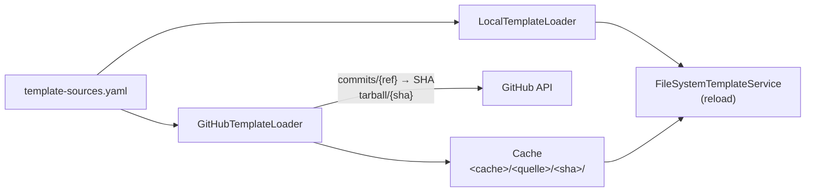

# Template-Quellen: Templates aus Git-Repositories

Der Katalog muss nicht aus dem lokalen `templates/`-Ordner kommen. Das Backend
kann AppTemplates aus beliebig vielen **Quellen** laden: lokale Verzeichnisse
und (Unter-)Ordner von GitHub-Repositories. Jede Quelle wird von einem
`TemplateLoader` (`apps/skip-api/templates/sources.py`) in ein lokales
Verzeichnis überführt; Parsing und Validierung sind danach identisch.



## Aufbau eines Template-Repositories

```
skip-templates/
├── README.md
├── templates/                      # ← path: templates  (Sammlung)
│   ├── jupyter/
│   │   ├── template.yaml           # Pflicht
│   │   ├── README.md               # spec.description.file
│   │   └── logo.svg                # spec.logo.file
│   └── marimo/
│       ├── template.yaml
│       └── image/Dockerfile        # baut die CI des Repos; die Plattform nutzt nur `image:`
└── .github/workflows/validate.yaml # Templates validieren, Images bauen, Releases taggen
```

Ein Projekt-Repo kann auch **ein einzelnes Template** mitbringen, z. B. unter
`deploy/skip-template/template.yaml`.

Regeln für den Ordner, auf den `path` zeigt:

- Enthält er selbst eine `template.yaml`, ist er **ein Template**.
- Sonst ist jeder Unterordner mit `template.yaml` ein Template (**Sammlung**).
- Assets (README, Logo) werden relativ zum Template-Ordner referenziert und dürfen ihn nicht verlassen.

## Konfiguration

Die Quellen stehen in einer YAML-Datei, deren Pfad `TEMPLATE_SOURCES_FILE`
angibt (im Cluster die ConfigMap `template-sources`,
`deploy/skip-api/template-sources.yaml`):

```yaml
sources:
  - name: builtin              # eindeutig, [a-z0-9-]; wird auch als Cache-Ordner genutzt
    type: local
    path: /templates
  - name: fhswf
    type: github
    repository: fhswf/skip-templates
    ref: v1.3.0                # Tag oder Commit-SHA; ein Branch folgt bei jedem Reload
    path: templates            # Unterordner im Repo (leer = Repo-Wurzel)
    tokenEnv: GITHUB_TEMPLATES_TOKEN   # Default; Env-Variable mit dem Token (optional)
    apiUrl: https://api.github.com     # Default; für GitHub Enterprise anpassen
  - name: ki-lab
    type: github
    repository: fhswf/ki-lab-app
    ref: 4f2c1e9d0c3b8a7f6e5d4c3b2a1f0e9d8c7b6a5f
    path: deploy/skip-template # einzelnes Template
```

Für Entwicklung und schnelle Tests gibt es eine Kurzform in `TEMPLATE_SOURCES`
(kommagetrennt):

```bash
TEMPLATE_SOURCES="github:fhswf/skip-templates@v1.3.0#templates,local:/srv/extra"
```

`@` trennt den Ref ab (Default: Standard-Branch), `#` den Unterordner.

| Variable | Bedeutung |
|---|---|
| `TEMPLATE_SOURCES_FILE` | Pfad zur Quellen-Datei (hat Vorrang) |
| `TEMPLATE_SOURCES` | Kurzform, wenn keine Datei gesetzt ist |
| `TEMPLATES_DIR` | Fallback: ein lokales Verzeichnis (Default `templates/` im Repo) |
| `TEMPLATES_CACHE_DIR` | Cache für entpackte Snapshots (Default: `$TMPDIR/skip-templates`) |
| `GITHUB_TEMPLATES_TOKEN` | Token für private Repos und höhere Rate-Limits (im Secret `platform-env`) |

Das lokale Overlay setzt `TEMPLATE_SOURCES_FILE` leer und nutzt weiter das
gemountete `templates/` über `TEMPLATES_DIR`.

## Verhalten beim Laden

- Der `ref` wird bei jedem Reload auf einen Commit-SHA aufgelöst. Liegt der Snapshot schon im Cache, wird nichts heruntergeladen; ältere Snapshots derselben Quelle werden gelöscht.
- Heruntergeladen wird der Tarball des Commits; entpackt wird nur `path`. Das Entpacken nutzt den `data`-Filter von `tarfile` (keine absoluten Pfade, keine Links aus dem Ziel heraus), das Archiv ist auf 100 MiB begrenzt.
- Ist GitHub nicht erreichbar, wird der letzte Snapshot weiterverwendet.
- Fehler betreffen nur ihre Quelle bzw. ihr Template; der Rest des Katalogs lädt trotzdem.
- Bei doppelten Template-Namen gewinnt die zuerst konfigurierte Quelle.
- `source` und `revision` (Commit-SHA) stehen in jeder Katalog-Antwort.

`POST /api/templates/reload` holt neue Versionen und meldet Probleme:

```bash
curl -X POST -H 'X-User: dev@skip.de' http://api.localhost:8080/api/templates/reload
# {"templates": 3, "errors": []}
```

## Weitere Quellen

Neue Quelltypen (z. B. GitLab oder ein generischer Git-Server) implementieren
das Protokoll

```python
class TemplateLoader(Protocol):
    source: str
    def fetch(self) -> TemplateSnapshot: ...  # lokaler Ordner + Revision
```

und werden in `build_loader()` sowie als weiterer `type` in
`TemplateSourceSpec` ergänzt.
