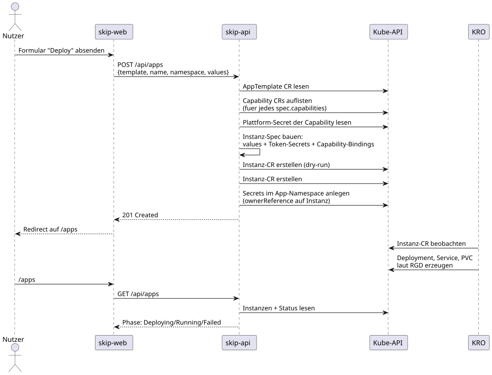

# Deploy-Ablauf

Vom Klick im Formular bis zur laufenden App:

1. **Formular absenden** — skip-web schickt `POST /api/apps` mit Template-Name,
   App-Name, Namespace und den Formularwerten.
2. **Template rendern** — die API liest das AppTemplate aus `templates/<name>/`,
   validiert die Formularwerte gegen `spec.parameters` (Typen, Enum-Werte,
   Muster; unbekannte Felder → 422) und setzt sie per `${parameters.…}` in die
   Komponente ein (`apps/skip-api/deploy/render.py`).
3. **Berechtigungen prüfen** — Namespace laut Authentik-Gruppen, Anzahl der
   eigenen Apps, CPU/Memory-Limits und Capability-Klassen laut
   `EntitlementProvider` (derzeit ein Mock, siehe Template-Modell).
4. **Je Komponente ein Instanz-Spec bauen** — `image`, `command`/`args`,
   `ports`, `servicePorts` (aus `expose`), `resources`, `storage`/`volumes` und
   die `env`-Liste: Komponenten-Variablen (mit `${components.<name>.host}` für
   andere Komponenten) plus Capability-Bindings als `secretKeyRef` auf
   `<app>-<capability>-credentials` (`endpoint`, `api-key`).
5. **Validieren und anlegen** — erst ein Dry-Run aller Instanzen gegen die
   `Application`-CRD (Schema-Fehler → 422), dann die echten Creates
   (`<app>-<komponente>`). Anschließend legt die API die `CapabilityClaim`s im
   App-Namespace an, mit `ownerReferences` auf alle Instanzen — Löschen der App
   räumt sie automatisch mit auf. Schlägt ein Schritt fehl, werden bereits
   angelegte Instanzen wieder entfernt.
6. **KRO und Operator übernehmen** — KRO erzeugt je Instanz ServiceAccount,
   Service, PVC und Deployment aus der Application-RGD; der
   `capability-operator` bearbeitet die Claims und legt die Secrets an, auf die
   die Pods warten.

## Status

Die App-Übersicht (`/deployments`) fragt `GET /api/apps` ab. Die API gruppiert
die Instanzen per Label `platform.skip.de/app` zu einer App mit `components[]`
und leitet je Komponente die Phase aus dem Instanz-Status ab, den KRO aus den
erzeugten Ressourcen speist (z. B. `availableReplicas`). Die App-Phase ist
`Failed`, sobald eine Komponente fehlschlägt, `Running`, wenn alle laufen,
sonst `Deploying`:

| Phase | Bedeutung |
| --- | --- |
| `Deploying` | Instanz angelegt, Workload noch nicht bereit |
| `Running` | mindestens ein Replica verfügbar |
| `Failed` | eine Status-Condition meldet einen Fehler |

## Berechtigungen

Nur der ServiceAccount `platform-backend` darf Instanzen anlegen; Ownership
wird über das Label `platform.skip.de/owner` erzwungen — Status und Delete
prüfen, dass die App dem anfragenden Nutzer gehört. Deploys sind auf die
per `ALLOWED_NAMESPACES` freigegebenen Tenant-Namespaces beschränkt.
