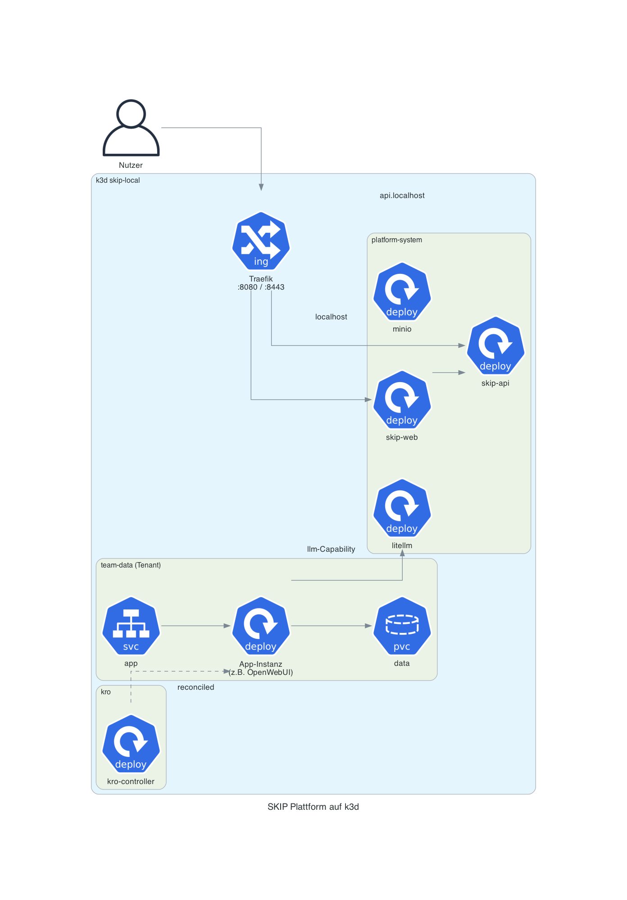
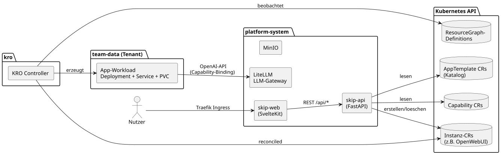

# Architektur — Überblick

SKIP ist eine Self-Service-Plattform: Nutzer wählen im Web-Katalog ein
App-Template, konfigurieren es über ein generiertes Formular und bekommen die
Anwendung in ihrem Team-Namespace deployt. Die Plattform selbst besteht aus
wenigen Komponenten — die eigentliche Orchestrierung übernimmt Kubernetes
zusammen mit [KRO](https://kro.run).

## Laufzeitsicht

Alles läuft in einem k3d-Cluster (`skip-local`). Traefik routet per
Host-Regel: `localhost` auf das Frontend, `api.localhost` auf das Backend,
`auth.localhost` auf Authentik (alles über den k3d-Loadbalancer auf Port 8080/8443).

| Komponente | Namespace | Aufgabe |
| --- | --- | --- |
| **skip-web** (SvelteKit) | `platform-system` | Katalog, Deploy-Formular, App-Übersicht |
| **skip-api** (FastAPI) | `platform-system` | Einzige Komponente mit Kubernetes-Rechten; liest Katalog/Capabilities, erstellt Instanzen |
| **Authentik** | `authentik` | Identity Provider (OIDC); stellt die Tokens aus, die `skip-api` prüft, und hält die App-Gruppen fürs Sharing |
| **LiteLLM** | `platform-system` | OpenAI-kompatibles LLM-Gateway, als `llm`-Capability angeboten |
| **MinIO** | `platform-system` | Objektspeicher |
| **KRO-Controller** | `kro` | Reconciled Instanz-CRs zu Deployment/Service/PVC laut ResourceGraphDefinition |
| **App-Instanzen** | `team-data` (Tenant) | Von Nutzern deployte Anwendungen |

Endnutzer haben keinerlei direkte Kubernetes-Rechte — jede Aktion läuft über
die skip-api, die mit dem ServiceAccount `platform-backend` arbeitet.

## Komponenten und Datenflüsse

Drei Custom-Resource-Arten (Gruppe `platform.skip.de`) bilden den Zustand der
Plattform ab:

- **AppTemplate** — der Katalogeintrag: Metadaten, Konfigurations-Schema,
  Formular-Hinweise, angeforderte Capabilities. Wird aus den Template-Quellen
  im Repo gerendert (siehe [Template-Modell](template-model.md)).
- **Capability** — ein geteilter Plattformdienst (z. B. LiteLLM) mit
  Verbindungsdaten, den Templates deklarativ anfordern können.
- **Instanz-CRs** (Gruppe `kro.run`, z. B. `OpenWebUI`) — eine deployte App.
  Die CRD dazu generiert KRO aus der ResourceGraphDefinition des Templates.

Wie ein Deploy im Detail abläuft, zeigt der [Deploy-Ablauf](deployment-flow.md).
