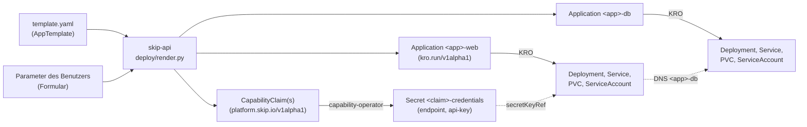

# Template-Modell

Ein **AppTemplate** beschreibt eine Anwendung deklarativ: Katalog-Metadaten, die
Parameter, die ein Benutzer beim Deploy setzt, die angeforderten
Plattform-Capabilities und die Komponenten, aus denen die App besteht. Templates
sind Verzeichnisse unter `templates/<name>/`; die einzige Pflichtdatei ist
`template.yaml` (`platform.skip.io/v1alpha1`, `kind: AppTemplate`).

Ein AppTemplate ist **keine CRD**. Das Backend liest es aus dem Dateisystem (lokal
oder als Snapshot eines Git-Repos, siehe [Template-Quellen](../app-templates/sources.md)) und
übersetzt es beim Deploy in **eine Instanz der generischen Application-RGD je
Komponente** (`deploy/crds/application-rgd.yaml`) plus **CapabilityClaims** für
die App.



## Aufbau eines Templates

```
templates/jupyter/
├── template.yaml   # AppTemplate
├── README.md       # Markdown-Beschreibung für den Katalog (optional)
└── logo.svg        # Logo (optional)
```

## Das Format

```yaml
apiVersion: platform.skip.io/v1alpha1
kind: AppTemplate
metadata:
  name: jupyter-notebook

spec:
  displayName: Jupyter Notebook
  summary: Managed Jupyter Notebook environment
  version: 1.0.0
  author: Skip Platform
  categories: [development, data-science]
  tags: [python, jupyter]
  description: { format: markdown, file: README.md }
  logo: { file: logo.svg }

  parameters:
    - name: size
      displayName: Größe
      type: enum
      default: small
      values:
        - name: small
          displayName: Small (1 CPU, 2 GiB)
          cpu: "1"          # Zusatzfelder pro Enum-Wert …
          memory: 2Gi
        - name: large
          displayName: Large (4 CPU, 8 GiB)
          cpu: "4"
          memory: 8Gi
    - name: storageSize
      type: string
      pattern: "^[0-9]+(Mi|Gi)$"
      default: 5Gi
    - name: llmAccess
      type: boolean
      default: false

  capabilities:
    - name: llm
      type: llm-access
      class: standard
      when: ${parameters.llmAccess}     # optional: nur anfordern, wenn wahr
      properties:
        models: [mistral-small, mistral-large]

  components:
    - name: jupyter
      image: quay.io/jupyter/minimal-notebook
      command: []                        # optional, ebenso args
      ports:
        - { name: http, containerPort: 8888 }
      expose:
        - { name: notebook, type: http, port: http }
      env:
        - { name: JUPYTER_ENABLE_LAB, value: "yes" }
        - { name: DATABASE_URL, value: "postgresql://x:y@${components.db.host}:${components.db.ports.pg}/x" }
      resources:
        requests: { cpu: "${parameters.size.cpu}", memory: "${parameters.size.memory}" }
        limits:   { cpu: "${parameters.size.cpu}", memory: "${parameters.size.memory}" }
      storage:
        size: ${parameters.storageSize}   # … und ${parameters.<name>} für den Wert selbst
        mountPath: /home/jovyan/work
      bindings:
        - capability: llm
          env:
            endpoint: OPENAI_BASE_URL
            credential: OPENAI_API_KEY

    - name: db                            # weitere Komponente = eigene Instanz
      image: docker.io/library/postgres:16-alpine
      ports:
        - { name: pg, containerPort: 5432 }
      expose:
        - { name: pg, type: tcp, port: pg }
      env:
        - { name: POSTGRES_PASSWORD, value: secret }
      storage:
        size: 1Gi
        mountPath: /var/lib/postgresql/data
```

| Abschnitt | Bedeutung |
| --- | --- |
| `spec.displayName`, `summary`, `version`, `author`, `categories`, `tags` | Katalog-Metadaten |
| `spec.description` / `spec.logo` | Beschreibung (Datei oder `inline`) und Logo im Template-Verzeichnis |
| `spec.parameters` | Nutzereingaben. Typen: `string` (mit `pattern`), `integer`/`number` (mit `minimum`/`maximum`), `boolean`, `enum` (mit `values`). `advanced: true` versteckt das Feld hinter „Erweiterte Einstellungen“. |
| `spec.capabilities` | Angeforderte Plattformdienste; je Eintrag entsteht ein `CapabilityClaim` `<app>-<name>` mit `spec.type` und `spec.properties`. `when` macht die Capability optional. `class` ist für Berechtigungen gedacht (siehe unten). |
| `spec.components` | Die Komponenten der App. Jede wird zu einer eigenen Application-Instanz `<app>-<komponente>` mit Deployment, ServiceAccount, optionalem Service (`expose`) und optionalem PVC (`storage`). Felder: `image`, `command`, `args`, `ports`, `expose`, `env`, `resources`, `storage`, `bindings`. Komponentennamen: Kleinbuchstaben, max. 16 Zeichen. |
| `components[].expose` | Gibt Container-Ports (per Name) als Service-Ports frei. Ohne `expose` entsteht kein Service. `type: http` erzeugt zusätzlich einen Ingress: die erste HTTP-Komponente unter `<app>.<namespace>.<APPS_DOMAIN>`, weitere unter `<app>-<komponente>.…` (siehe [Ingress & Routing](../deployment/ingress.md)). `type: tcp` nur clusterintern. |
| `components[].bindings` | Verbindet eine Capability mit Umgebungsvariablen: `endpoint` und `credential` werden per `secretKeyRef` aus dem Secret des Claims (`<app>-<capability>-credentials`, Schlüssel `endpoint` und `api-key`) gesetzt. |

### Referenzen

Überall in `capabilities` und `components` sind Referenzen erlaubt:

- `${parameters.<name>}` – der eingegebene Wert (bei Enums der Name des gewählten Werts).
- `${parameters.<name>.<feld>}` – ein Zusatzfeld des gewählten Enum-Werts, z. B. `${parameters.size.cpu}`.
- `${app.name}` / `${app.namespace}` – Name und Namespace des Deployments.
- `${components.<name>.host}` – der Service-/DNS-Name der Komponente (`<app>-<name>`), `${components.<name>.ports.<port>}` – ihre Portnummer. So sprechen Komponenten einander an.
- Referenzen dürfen in Strings eingebettet sein (`"size-${parameters.size}"`); besteht ein String nur aus einer Referenz, bleibt der Typ des Werts erhalten.

## Übersetzung in die Application-RGD

`apps/skip-api/deploy/render.py` erzeugt aus Template und Parametern:

1. **Validierte Werte**: Defaults anwenden, Typen umwandeln (Formulare senden Strings), Enum-Werte, Muster und Grenzen prüfen, unbekannte Parameter ablehnen.
2. **Je Komponente ein Application-Spec**: `app`/`component` (Gruppierung), `image`, `command`, `args`, `ports`, `servicePorts` (aus `expose`), `env` (Komponenten-`env` plus Bindings), `resources`, `storage.enabled`/`size` und `volumes`/`volumeMounts` (PVC `<instanz>`), `ingress.enabled`/`host`/`className`/`portName` für HTTP-Komponenten.
3. **CapabilityClaims**: für jede aktive Capability ein Claim `<app>-<capability>` – Claims gehören zur App, nicht zu einer Komponente.

Der Deploy-Service prüft erst alle Instanzen per Dry-Run, legt sie dann an und danach die Claims mit `ownerReferences` auf **alle** Instanzen der App. Schlägt ein Schritt fehl, werden bereits angelegte Instanzen wieder entfernt. Alle Instanzen tragen die Labels `platform.skip.de/app`, `platform.skip.de/component`, `platform.skip.de/template` und `platform.skip.de/owner`; die API (`GET /api/apps`) gruppiert sie zu einer App mit `components[]` und aggregiertem Status (`Failed` > `Deploying` > `Running`). Löschen entfernt alle Instanzen; Claims, Secrets und der virtuelle Gateway-Key verschwinden per Garbage Collection, sobald die letzte Instanz weg ist.

Die Application-RGD nimmt Listen (`env`, `ports`, `volumes`, …) im Kubernetes-Format entgegen und reicht sie unverändert durch; Service, PVC und Ingress entstehen nur bei Bedarf (`includeWhen`), leere Listen werden weggelassen. Die API liefert die öffentliche URL der App (`url`, erste HTTP-Komponente) und je Komponente (`components[].url`). Bis ein Claim-Secret existiert, bleibt der Pod in `CreateContainerConfigError` und startet danach von selbst; Komponenten, die auf andere warten (z. B. eine Datenbank), starten nach einem Restart von selbst, weil die Services sofort angelegt werden.

## Berechtigungen (vorbereitet)

`apps/skip-api/auth/entitlements.py` definiert die Schnittstelle `EntitlementProvider` und ein Mock (`StaticEntitlementProvider`) mit Grenzen pro Benutzer: maximale Anzahl Apps, CPU/Memory-Limit pro App und erlaubte Capability-Klassen. Die Werte kommen aus `MAX_APPS_PER_USER`, `MAX_CPU_PER_APP`, `MAX_MEMORY_PER_APP` und `ALLOWED_CAPABILITY_CLASSES`; Mitglieder von `skip-admins` sind unbegrenzt. Der Deploy-Service prüft sie vor dem Anlegen der Instanz, `GET /api/me` liefert sie als `entitlements`. Eine echte Zuordnung (z. B. über Authentik-Gruppen oder Tenants) kann diese Schnittstelle später implementieren.

## Demos

Im Repository liegen drei Templates im neuen Format: `jupyter` (Enum-Größen, optionaler LLM-Zugang), `marimo` (eigenes Image) und `openwebui` (zwei Komponenten: Web-UI und PostgreSQL, Pflicht-Capability `llm`).
