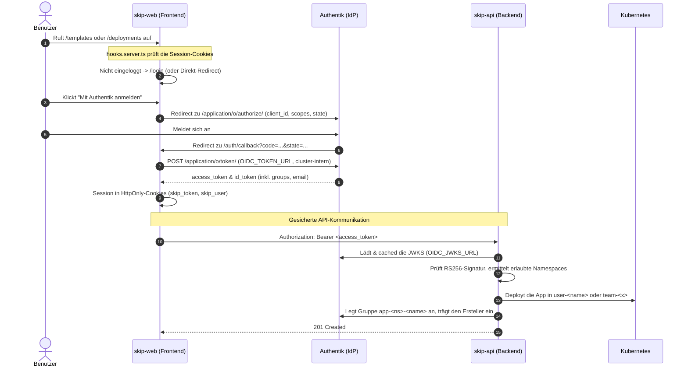
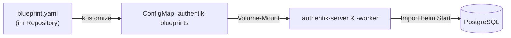
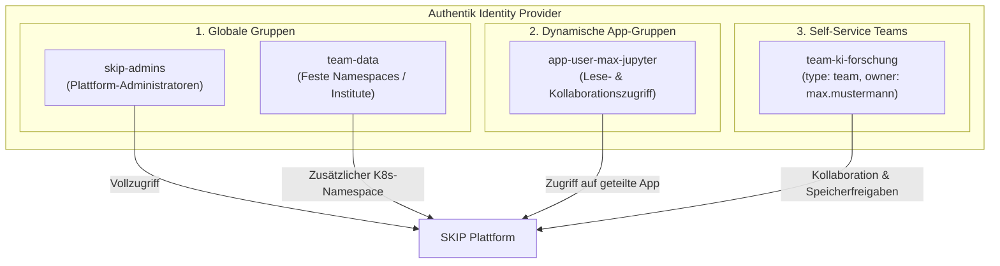
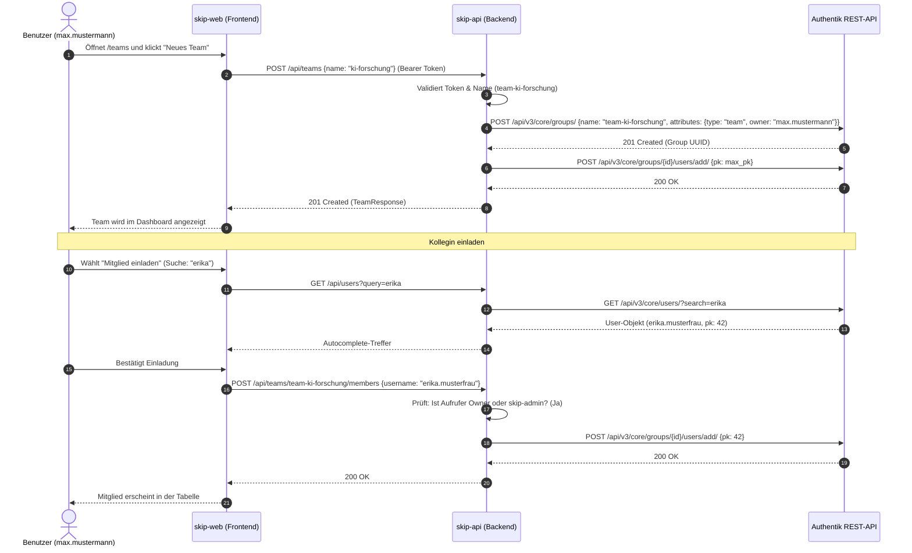

# Authentik (Identity & Access Management)

[Authentik](https://goauthentik.io/) ist der Identity Provider (IdP) und Single-Sign-On-Dienst (SSO) der SKIP-Plattform. Er authentifiziert Benutzer per **OpenID Connect (OIDC)** für das Frontend (`skip-web`) und stellt die JWT-Bearer-Tokens aus, die das Backend (`skip-api`) validiert. Zusätzlich verwaltet das Backend über die Authentik-REST-API pro App eine Gruppe, mit der Apps geteilt werden.

!!! info "Zuständigkeit"
    Wie MinIO und LiteLLM ist Authentik ein [Shared Service](services.md): Das produktive Authentik betreibt das Infrastruktur-Repository. Dieses Repository liefert nur die Integration (OIDC-Client, JWT-Validierung, Gruppenverwaltung) und eine lokale **Dev-Fixture** unter `deploy/local/dependencies/authentik/`, die `make install-authentik` in den Namespace `authentik` installiert.

---

## 🔑 Zugangsdaten & URLs (lokale Umgebung)

| Parameter | Wert |
| :--- | :--- |
| **Web-UI (Ingress)** | [http://auth.localhost:8080](http://auth.localhost:8080) |
| **Admin-Interface** | [http://auth.localhost:8080/if/admin/](http://auth.localhost:8080/if/admin/) |
| **Administrator** | `akadmin` / `AdminPw` (Gruppen `authentik Admins`, `skip-admins`) |
| **Testbenutzer** | `max.mustermann` / `Start123!` (Gruppe `team-data`) |
| **OIDC-Issuer** | `http://auth.localhost:8080/application/o/skip-platform/` |
| **Cluster-intern** | `http://authentik-server.authentik.svc.cluster.local:9000` |

Alle Benutzer, Gruppen, der OIDC-Provider und der API-Token für das Backend werden beim ersten Start automatisch per **Blueprint** angelegt – es ist keine Klickarbeit nötig.

---

## 🔄 Ablauf der Authentifizierung



---

## 📜 Automatisches Seeding via Blueprint

`deploy/local/dependencies/authentik/blueprint.yaml` wird per Kustomize zur ConfigMap `authentik-blueprints` und in Server und Worker unter `/blueprints/custom/skip-platform.yaml` gemountet. Authentik importiert die Datei beim Start:



Inhalt des Blueprints:

1. **Gruppen**: `skip-admins` (Vollzugriff auf alle Namespaces und Apps) und `team-data` (Standard-Tenant).
2. **Scope-Mapping `groups`**: schreibt die Gruppennamen des Benutzers in den Token (`request.user.groups.all()`).
3. **OAuth2/OIDC-Provider `SKIP Platform Provider`**: `client_id`/`client_secret` per `!Env` aus `OIDC_CLIENT_ID`/`OIDC_CLIENT_SECRET`, Signatur mit dem selbstsignierten Authentik-Zertifikat (RS256), Redirect-URIs `http://localhost:8080/auth/callback` (Ingress) und `http://localhost:5173/auth/callback` (`npm run dev`).
4. **Application `skip-platform`**, mit dem Provider verknüpft.
5. **Benutzer**: `akadmin` und `max.mustermann` (Passwörter als `password_hash`).
6. **API-Token `skip-backend-api-token`** für `skip-api`, Wert per `!Env` aus `AUTHENTIK_API_TOKEN`.

Die `!Env`-Werte kommen aus `deploy/local/.env`; `make install-authentik` schreibt sie in das Secret `authentik-env`. Die Defaults im Blueprint entsprechen `.env.example`, damit alles auch ohne Anpassung zusammenpasst.

??? tip "Passwort-Hash für den Blueprint erzeugen"
    ```bash
    kubectl exec -n authentik deployment/authentik-worker -- python3 -c "
    import django, os
    os.environ.setdefault('DJANGO_SETTINGS_MODULE', 'authentik.root.settings')
    django.setup()
    from django.contrib.auth.hashers import make_password
    print(make_password('MeinPasswort123!'))
    "
    ```
    `password:` (Klartext, wird beim Import gehasht) funktioniert ebenfalls; `password_hash:` übernimmt den Hash unverändert.

---

## 👤 Benutzerverwaltung & Bereitstellung

!!! warning "Benutzeranlage ausschließlich über Authentik"
    Neue Benutzerkonten können **nicht** über die SKIP-Plattform angelegt werden. Die Verwaltung von Identitäten (Neuanlage, Passwortvergabe, Passwort-Reset, 2-Faktor-Authentifizierung, Aktivierung/Sperrung) obliegt **ausschließlich dem Identity Provider Authentik** bzw. einem daran angebundenen Verzeichnisdienst (z. B. Active Directory, OpenLDAP, SAML/OIDC-Upstream).

    **Zero-Password-Policy der Plattform:**
    Das Plattform-Frontend (`skip-web`) und das Backend (`skip-api`) verarbeiten oder speichern zu keinem Zeitpunkt Benutzerpasswörter. Die Authentifizierung erfolgt vollständig out-of-band via OIDC-Redirect im Browser. Die Plattform erhält nach erfolgreichem Login lediglich ein kryptografisch signiertes JWT (Bearer-Token) mit den Identitätsdaten und Gruppenmitgliedschaften.

### Neuen Benutzer in Authentik anlegen (Admin-UI)

1. Öffne die Authentik Admin-Oberfläche: [http://auth.localhost:8080/if/admin/](http://auth.localhost:8080/if/admin/)
2. Melde dich als Administrator an (lokale Umgebung: `akadmin` / `AdminPw`).
3. Navigiere zu **Directory** $\rightarrow$ **Users** und klicke auf **Create**.
4. Trage **Username** (z. B. `erika.musterfrau`), **Name** und **Email** ein.
5. Klicke auf den neu angelegten Benutzer, wähle den Reiter **Password** und setze ein Initialpasswort.
6. Optional: Weise den Benutzer unter **Groups** einer globalen Gruppe zu (z. B. `team-data` oder `skip-admins`).
7. Der Benutzer kann sich nun sofort an der SKIP-Plattform anmelden und über die Autocomplete-Suche von Kollegen gefunden und in Apps oder Teams eingeladen werden.

---

## 👥 Gruppen-Konzepte: Globale Gruppen, App-Gruppen & Teams

In der SKIP-Plattform existieren drei klar voneinander abgegrenzte Arten von Gruppen in Authentik:



| Gruppentyp | Namensschema | Verwaltet durch | Zweck & Berechtigungen |
| :--- | :--- | :--- | :--- |
| **Globale Gruppen** | `skip-admins`, `team-data` | Authentik-Admin / Blueprint / LDAP | Plattformweite Rollen, Berechtigung für globale Kubernetes-Namespaces (`ALLOWED_NAMESPACES`). |
| **App-Gruppen** | `app-<namespace>-<name>` | `skip-api` (automatisch beim Deploy) | Sharing einzelner App-Instanzen. Mitglieder sehen die App in ihrem Workspace. Löschung erfolgt mit App-Uninstall. |
| **Self-Service Teams** | `team-<teamname>` | Benutzer via `skip-web` (`/teams`) | Selbstorganisierte Arbeitsgruppen für Institute, Vorlesungen oder Projekte. Werden für Speicher- und Workspace-Freigaben genutzt. |

---

## 🤝 Self-Service Teams

Mit Self-Service Teams können normale Plattform-Nutzer eigenständig Arbeitsgruppen gründen und Kollegen zur Zusammenarbeit einladen, ohne dass ein Systemadministrator in Authentik eingreifen muss.

### Architektur & Berechtigungsmodell

1. **Gründung:**
   - Jeder authentifizierte Benutzer kann über die Navigation **Teams** (`/teams`) ein neues Team erstellen (z. B. `team-ki-forschung`).
   - Das Backend (`skip-api`) validiert den Namen und legt die Gruppe in Authentik an.
   - Die Gruppe erhält in Authentik strukturierte Metadaten-Attribute:
     ```json
     {
       "type": "team",
       "owner": "max.mustermann"
     }
     ```
   - Der Ersteller wird automatisch als erstes Mitglied in die Gruppe eingetragen.

2. **Mitgliederverwaltung:**
   - **Rollen:** Der Ersteller gilt als **Besitzer** (`Owner`). Alle anderen Mitglieder sind reguläre **Mitglieder**.
   - **Rechte:** Nur der Besitzer des Teams (sowie Plattform-Administratoren der Gruppe `skip-admins`) darf weitere Mitglieder hinzufügen oder entfernen.
   - **Benutzerauswahl:** Neue Mitglieder werden über die Autocomplete-Suche (`GET /api/users?query=...`) aus den in Authentik registrierten Benutzern ausgewählt.
   - Reguläre Mitglieder können das Team jederzeit eigenständig verlassen.

3. **Auflösung:**
   - Nur der Besitzer oder ein `skip-admin` kann das Team löschen (`DELETE /api/teams/{name}`).
   - Das Backend entfernt die Gruppe rückstandsfrei aus Authentik.

### Ablauf: Team anlegen & Mitglieder einladen



---

## 👥 Rollen & Namespaces

| Wer | Darf deployen nach | Sieht |
| :--- | :--- | :--- |
| Jeder Benutzer | persönlicher Namespace `user-<username>` (wird beim ersten Deploy angelegt) | eigene Apps |
| Mitglied einer Gruppe aus `ALLOWED_NAMESPACES` (z. B. `team-data`) | zusätzlich den gleichnamigen Namespace | eigene Apps |
| Mitglied einer App-Gruppe `app-<ns>-<name>` | – | die geteilte App (lesend, kein Löschen) |
| `skip-admins` | alle Namespaces | alle Apps, mit Owner-Rechten |

**App-Sharing**: Beim Deploy legt `skip-api` in Authentik die Gruppe `app-<namespace>-<name>` an und trägt den Ersteller ein. Über *Teilen* in der Deployments-Ansicht fügt der Besitzer weitere Benutzer hinzu (`POST /api/apps/{tpl}/{ns}/{name}/members`); sie sehen die App sofort in ihrer Liste, weil das Backend die Mitgliedschaft live bei Authentik nachfragt (der Token enthält nur die Gruppen zum Login-Zeitpunkt). Beim Löschen der App wird die Gruppe entfernt.

---

## 💻 Implementierung

### Frontend (`apps/skip-web`)

- `src/hooks.server.ts`: Auth-Gate. Liest `skip_token`/`skip_user`, leitet Unangemeldete auf `/login` (oder mit `AUTH_DIRECT_REDIRECT=true` direkt zu Authentik).
- `src/lib/server/auth.ts`: `createAuthorizationUrl`, `exchangeCode` (nutzt `OIDC_TOKEN_URL`, sonst den Issuer), `extractUserProfile`, `getApiAuthHeaders` (setzt `Authorization: Bearer`, ohne Token lokal `X-User`).
- `src/routes/auth/{login,callback,logout}`: OIDC-Handshake; `src/routes/login`: SKIP-Login-Seite.
- `src/routes/deploy/[id]`: Namespace-Auswahl aus `GET /api/namespaces`; `src/routes/deployments`: Owner/Mitglied-Badges und Freigabe-Dialog.
- `src/routes/teams/`: Self-Service Teams Dashboard (`+page.svelte`), Anlage-Modal, Mitgliederverwaltung und Einladungs-Dialog (`+page.server.ts`).
- `src/lib/components/app-sidebar.svelte`: Navigationsleiste mit direktem Link zu `/teams`.

### Backend (`apps/skip-api/`)

- `auth/oidc.py`: `get_current_user` (Bearer-JWT via JWKS, lokal `X-User`-Fallback), `OidcSettings` aus `OIDC_*`.
- `auth/authentik.py`: REST-Client mit erweiterten Methoden:
  - App-Gruppen: `create_app_group`, `add_user_to_app_group`, `remove_user_from_app_group`, `get_app_group_members`.
  - Self-Service Teams: `create_team`, `list_teams`, `get_team`, `add_user_to_team`, `remove_user_from_team`, `delete_team`.
  - Benutzersuche: `search_users`, `get_user_by_username`.
- `auth/service.py`: `user_namespace_name`, `allowed_namespaces_for` (persönlich + Gruppen, Admins alles).
- `auth/api.py`: `GET /api/me`, `GET /api/namespaces`, `GET /api/users?query=`.
- `teams/`: Dediziertes Modul für Self-Service Teams (`dtos.py`, `errors.py`, `service.py`, `api.py` mit Router unter `/api/teams`).
- `deploy/service.py`: setzt die Zugriffsregeln um (Owner-Label, `skip-admins`, App-Gruppe) und bietet `list_members`/`add_member`/`remove_member`.

---

## ⚙️ Umgebungsvariablen (`deploy/local/.env`)

| Variable | Verbraucher | Bedeutung |
| :--- | :--- | :--- |
| `AUTHENTIK_SECRET_KEY`, `AUTHENTIK_POSTGRES_PASSWORD` | Authentik | Secrets der Dev-Fixture (Secret `authentik-env`) |
| `AUTHENTIK_API_URL` | `skip-api` | REST-API, cluster-intern |
| `AUTHENTIK_API_TOKEN` | `skip-api`, Blueprint | API-Token für Gruppen/Mitglieder |
| `OIDC_ISSUER_URL` | `skip-web`, `skip-api` | Issuer über den Ingress (Browser-Redirects) |
| `OIDC_CLIENT_ID`, `OIDC_CLIENT_SECRET` | `skip-web`, Blueprint | OIDC-Client `SKIP Platform` |
| `OIDC_JWKS_URL` | `skip-api` | JWKS cluster-intern (leer = `<Issuer>/jwks/`) |
| `OIDC_TOKEN_URL` | `skip-web` | Token-Endpunkt cluster-intern (leer = aus dem Issuer abgeleitet) |
| `AUTH_DIRECT_REDIRECT` | `skip-web` | `false` = Login-Seite, `true` = direkter Redirect |

Alle Werte landen über Kustomize im Secret `platform-env` (`skip-api` und `skip-web` binden es per `envFrom`). Änderungen greifen nach `make install-authentik` (Fixture) bzw. einem Neustart von `make dev` (Plattform).

---

## 🛠️ Betrieb & Fehlersuche

```bash
make install-authentik                 # (neu) installieren, wartet auf den Rollout
make status                            # zeigt u. a. die Authentik-Pods
kubectl logs -n authentik deploy/authentik-worker | grep -i blueprint   # Blueprint-Import
curl -I -H "Host: auth.localhost" http://localhost:8080/               # Ingress-Test
```

| Problem | Ursache | Lösung |
| :--- | :--- | :--- |
| Login-Seite meldet „Token exchange failed“ | Authentik noch nicht bereit oder `OIDC_TOKEN_URL` falsch | `kubectl get pods -n authentik`, Werte in `.env` prüfen, `make dev` neu starten |
| Backend antwortet `401 Ungültiges Token` | JWKS nicht erreichbar (`OIDC_JWKS_URL`) oder Token abgelaufen | Backend-Logs, neu anmelden |
| Sharing schlägt fehl / keine Benutzer im Dialog | `AUTHENTIK_API_TOKEN` passt nicht zum Blueprint | `.env` prüfen, `make install-authentik` (Blueprint läuft erneut) |
| `make stop-local` / `start-local` | Cluster pausieren und fortsetzen, Daten bleiben erhalten | – |
| `make reset-local` | Cluster löschen; der Blueprint befüllt Authentik danach wieder | – |
