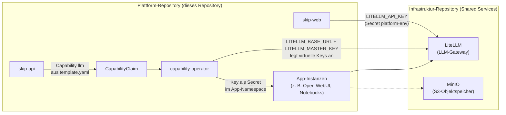
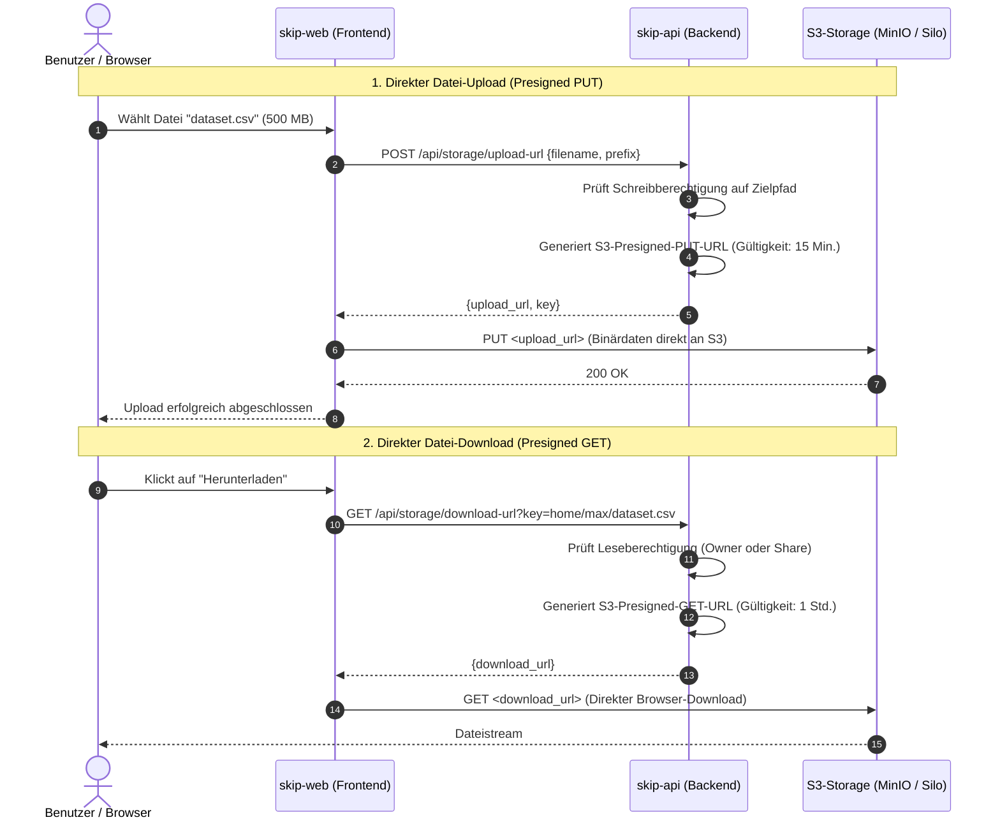

# Shared Services: MinIO & LiteLLM

!!! info "Authentik"
    Der Identity Provider Authentik ist ebenfalls ein Shared Service mit lokaler Dev-Fixture (`make install-authentik`); er hat eine eigene Seite: [Identity & SSO (Authentik)](authentik.md).

Neben der Control Plane (`skip-api`), der Benutzeroberfläche (`skip-web`) und dem `capability-operator` nutzt die SKIP-Plattform zentrale Basisdienste, die **nicht Teil dieses Repositorys** sind: einen S3-kompatiblen Objektspeicher (MinIO) und ein LLM-Gateway (LiteLLM). Sie werden als *Shared Services* vom Infrastruktur-Repository betrieben; diese Seite beschreibt, **wie die Plattform sie konsumiert**.

!!! info "Zuständigkeit"
    Gemäß der [Aufteilung zwischen Plattform- und Infrastruktur-Repository](../architecture/repository-boundary.md) verantwortet dieses Repository, *was* die Software zum Betrieb braucht; das Infrastruktur-Repository verantwortet, *wo und wie* sie betrieben wird – inklusive MinIO, LiteLLM, deren Persistenz, Secrets und Domains. In diesem Repository gibt es deshalb keine Manifeste mehr für diese Dienste, und `make init-local` startet sie nicht.



---

## 🪣 1. MinIO & Silo (S3-kompatibler Objektspeicher)

Die SKIP-Plattform nutzt einen S3-kompatiblen Objektspeicher ([MinIO](https://min.io/) in Produktion bzw. das leichtgewichtige [Silo](https://github.com/pgsty/silo) als lokale Dev-Fixture) als zentrales Persistenz- und Kollaborations-Backend für Dateien, Notebooks, Datensätze und ML-Modelle.

### 📁 1.1 Das Benutzer-Home-Verzeichnis

Jeder authentifizierte Plattformbenutzer erhält automatisch einen isolierten Speicherbereich im gemeinsamen Bucket:

```
s3://<S3_BUCKET_NAME>/
├── home/
│   ├── max.mustermann/             <-- Persönliches Home-Verzeichnis
│   │   ├── projekte/
│   │   │   └── datenanalyse.ipynb
│   │   ├── daten/
│   │   │   └── training_set.csv
│   │   └── README.md
│   └── erika.musterfrau/           <-- Isoliertes Verzeichnis anderer Nutzer
└── _shares/
    └── a1b2c3d4-e5f6-...json       <-- Freigabe-Metadaten
```

* **Namensraum-Isolation:** Benutzer können im Reiter *„Meine Dateien“* ausschließlich Objekte einsehen und verwalten, deren S3-Key mit ihrem Präfix `home/<username>/` beginnt. Ein Zugriff auf fremde Home-Pfade wird von `skip-api` strikt abgelehnt.
* **Virtuelle Ordnerhierarchie:** S3 kennt nativ keine echten Dateisystem-Ordner. Das Backend bildet Ordnerstrukturen über Schlüssel-Präfixe mit Slash-Trenner (`/`) und 0-Byte-Markerobjekten ab.
* **Breadcrumb-Navigation:** Das Frontend (`/storage`) parst den aktuellen Pfad und ermöglicht unterbrechungsfreies Browsen und Anlegen verschachtelter Unterordner.

---

### ⚡ 1.2 Performanter Up- und Download via Presigned URLs

Um die Control Plane (`skip-api`) nicht mit datenintensiven Dateiströmen (z. B. Gigabyte-große Datensätze oder Modell-Gewichte) zu überlasten, setzt die Plattform auf **AWS Signature Version 4 (SigV4) Presigned URLs**:



* **Vorteile:**
  - **Skalierbarkeit:** Keine RAM- oder CPU-Belastung des Backends durch Dateitransfers.
  - **Sicherheit:** Zeitlich streng limitierte URLs; keine dauerhaften S3-Credentials im Browser.
  - **Integrität:** Die Presigned URL bindet den exakten Ziel-Key; Manipulationen am Pfad führen zu Signaturfehlern (HTTP 403) am S3-Speicher.

---

### 🤝 1.3 Feingranulares Dateifreigabesystem (Sharing)

Benutzer können beliebige Dateien oder ganze Ordner aus ihrem Home-Verzeichnis gezielt mit Kollegen oder Arbeitsgruppen teilen:

1. **Freigabe-Ziele:**
   - **Einzelne Benutzer:** Gezielt über deren Benutzernamen (z. B. `erika.musterfrau`).
   - **Teams & Gruppen:** Über Authentik-Gruppennamen (z. B. das Self-Service Team `team-ki-forschung` oder `team-data`).
2. **Speicherung im S3-Register (`_shares/`):**
   - Freigaben werden nicht in einer relationalen Datenbank abgelegt, sondern direkt im S3-Bucket unter `_shares/<share_id>.json` persistiert:
     ```json
     {
       "share_id": "9f8a7c2b-...",
       "owner": "max.mustermann",
       "item_type": "folder",
       "item_name": "daten",
       "source_key": "home/max.mustermann/daten/",
       "shared_with": ["erika.musterfrau", "team-ki-forschung"],
       "created_at": "2026-09-22T20:00:00Z"
     }
     ```
3. **Berechtigungsprüfung bei Zugriff:**
   - Wenn ein Benutzer eine Datei anfordert oder herunterlädt, prüft `storage/service.py`:
     1. Ist der Benutzer der rechtmäßige Besitzer (`source_key.startswith(f"home/{user.username}/")`)?
     2. Falls nein: Existiert eine Freigabe für diesen Pfad, in der der Benutzer namentlich oder über seine aktuellen Gruppenmitgliedschaften gelistet ist?
4. **Kollaborations-UI:**
   - Im Frontend (`/storage`) trennt der Reiter *„Für mich freigegeben“* eigene Daten sauber von geteilten Daten.
   - Benutzer können geteilte Ordner öffnen, darin navigieren und die enthaltenen Dateien herunterladen.

---

### 🧪 1.4 Lokale Dev-Fixture mit Silo

Im lokalen Entwicklungscluster (`make dev`) wird anstelle des ressourcenintensiven MinIO-Stacks das leichtgewichtige Docker-Image **`pgsty/silo:latest`** als S3-Mock eingesetzt:

* **Deployment:** `deploy/local/dependencies/minio/deployment.yaml` (Namespace `minio`).
* **Installation:** `make install-minio` startet Silo und initialisiert den Standard-Bucket `skip-bucket`.
* **Erreichbarkeit:**
  - Cluster-intern: `http://minio.minio.svc.cluster.local:9000` (für `skip-api`).
  - Ingress / Browser: `http://s3.localhost:8080` (für direkte Presigned-URL Uploads/Downloads).
* **Vollständige S3-API:** Silo unterstützt alle benötigten Primitiven (`ListObjectsV2`, `PutObject`, `GetObject`, `DeleteObject`, `HeadObject` und AWS SigV4 Presigned URLs).

---

## 🤖 2. LiteLLM (KI & LLM Gateway)

[LiteLLM](https://www.litellm.ai/) fungiert als universeller OpenAI-kompatibler Proxy für über 100 verschiedene Large Language Models (LLMs).

### Einsatzzweck in SKIP
- **Einheitliche Schnittstelle**: Data Scientists und Entwickler können in ihren Notebooks und Apps denselben API-Standard nutzen – unabhängig davon, ob im Hintergrund OpenAI, Anthropic Claude, Google Gemini, Ollama oder vLLM läuft.
- **Zentrales Key-Management**: API-Schlüssel für externe Anbieter werden zentral im Gateway hinterlegt; Anwendungen erhalten pro Instanz einen eigenen virtuellen Key.
- **Rate-Limiting & Budgetierung**: Kontrolle von Token-Verbrauch und Zugriffsberechtigungen.

### Wie die Plattform LiteLLM konsumiert

Das Gateway selbst wird vom Infrastruktur-Repository betrieben. Dieses Repository liefert nur die Konfiguration und den Operator, der es benutzt:

| Variable (Secret `platform-env`) | Verbraucher | Bedeutung |
| :--- | :--- | :--- |
| `LITELLM_API_KEY` | `skip-web` | Wird per `envFrom` an das Frontend durchgereicht |
| `LITELLM_BASE_URL` | `capability-operator` | URL, über die der Operator das Gateway erreicht (intern) |
| `LITELLM_MASTER_KEY` | `capability-operator` | Master-Key, mit dem der Operator virtuelle Keys anlegt |
| `LITELLM_PUBLIC_BASE_URL` (optional) | `capability-operator` | Endpunkt, der den Anwendungen mitgeteilt wird (Standard: `LITELLM_BASE_URL`) |

Die Werte liegen lokal in `deploy/local/.env` und werden von Kustomize (`deploy/local/kustomization.yaml`) zum Secret `platform-env` im Namespace `platform-system` generiert; `skip-web` und `capability-operator` binden dieses Secret per `envFrom` ein.

**Ablauf beim Deploy einer App mit LLM-Zugang:**

1. Das Template fordert die Capability an und bindet sie an Umgebungsvariablen, z. B. in `templates/openwebui/template.yaml`:
   ```yaml
   spec:
     capabilities:
       - name: llm
         type: llm-access
         class: standard
         properties:
           models: [mistral-small, mistral-large]
     components:
       - name: open-webui
         bindings:
           - capability: llm
             env:
               endpoint: OPENAI_API_BASE_URL
               credential: OPENAI_API_KEY
   ```
2. `skip-api` legt beim Deploy den `CapabilityClaim` `<app>-llm` (`spec.type: llm-access`) im App-Namespace an, mit `ownerReference` auf die Application-Instanz.
3. Der `capability-operator` erzeugt über `LITELLM_BASE_URL`/`LITELLM_MASTER_KEY` einen virtuellen LiteLLM-Key für genau diesen Claim, schreibt ihn zusammen mit dem Endpoint in das Secret `<app>-llm-credentials` (Schlüssel `api-key` und `endpoint`) und setzt `status.binding` sowie die `Ready`-Condition.
4. Die Application-Instanz enthält die Bindings bereits als `env`-Einträge mit `secretKeyRef` auf dieses Secret; der Pod startet, sobald das Secret existiert. Welche Variablennamen die App bekommt, bestimmt allein das Template.

```bash
# Claims und ihren Status anzeigen
kubectl get claims -A
```

### Beispiel-Nutzung in einem Jupyter Notebook:

Endpunkt und Key stammen aus dem Capability-Binding bzw. dem vom Operator angelegten Secret und werden der App über die in ihrer RGD definierten Umgebungsvariablen bereitgestellt (hier die Namen, die auch Open WebUI verwendet) – niemals fest im Code hinterlegen:

```python
import os
from openai import OpenAI

# Anbindung über das LiteLLM-Gateway der Plattform
client = OpenAI(
    base_url=os.environ["OPENAI_API_BASE_URL"],  # Gateway-Endpunkt aus dem Capability-Binding
    api_key=os.environ["OPENAI_API_KEY"],        # virtueller Key aus dem Secret des Claims
)

response = client.chat.completions.create(
    model="gpt-4o-mini",
    messages=[{"role": "user", "content": "Erkläre mir das KRO-Prinzip auf Kubernetes in zwei Sätzen."}]
)

print(response.choices[0].message.content)
```

---

## 🧪 3. Lokale Entwicklung: LiteLLM & Silo als Dev-Fixtures

Für den lokalen Cluster gibt es leichtgewichtige Instanzen als Entwicklungs-Fixtures (laut [Repository-Grenze](../architecture/repository-boundary.md) erlaubt, nicht mit dem produktiven Setup zu verwechseln): Silo für S3 (`make install-minio`, siehe oben) und LiteLLM für LLM-Zugriffe.

- **Installation**: `make install-litellm` (Teil von `make init-local`) installiert das offizielle Helm-Chart `oci://ghcr.io/berriai/litellm-helm` in den eigenen Namespace `litellm` – bewusst getrennt von `platform-system`, weil Skaffold diesen Namespace bei Ctrl-C löscht. Das Chart bringt ein Standalone-Postgres mit, das LiteLLM für virtuelle Keys braucht.
- **Konfiguration**: `deploy/local/dependencies/litellm/values.yaml` definiert die Modelle `mistral-small` und `mistral-large` (Provider Mistral). Master-Key und Provider-Key kommen aus `deploy/local/.env` (`LITELLM_MASTER_KEY`, `MISTRAL_API_KEY`) und landen im Secret `litellm-env`. Ist `MISTRAL_API_KEY` leer, wird die Installation mit Hinweis übersprungen.
- **Erreichbarkeit**: `http://litellm.litellm.svc.cluster.local:4000` – das ist der Default von `LITELLM_BASE_URL` in `.env.example`, den der `capability-operator` nutzt.
- **Prüfen**: `kubectl get pods -n litellm`, danach `kubectl apply -f apps/capability-operator/examples/llm-access-claim.yaml` und `kubectl get claims -A` – der Claim sollte `Ready=True` zeigen und ein Secret `my-llm-credentials` mit dem virtuellen Key anlegen.

Um stattdessen gegen ein anderes Gateway zu entwickeln, `LITELLM_BASE_URL` und `LITELLM_MASTER_KEY` in `deploy/local/.env` anpassen und `make dev` neu starten (Kustomize generiert `platform-env` neu).
