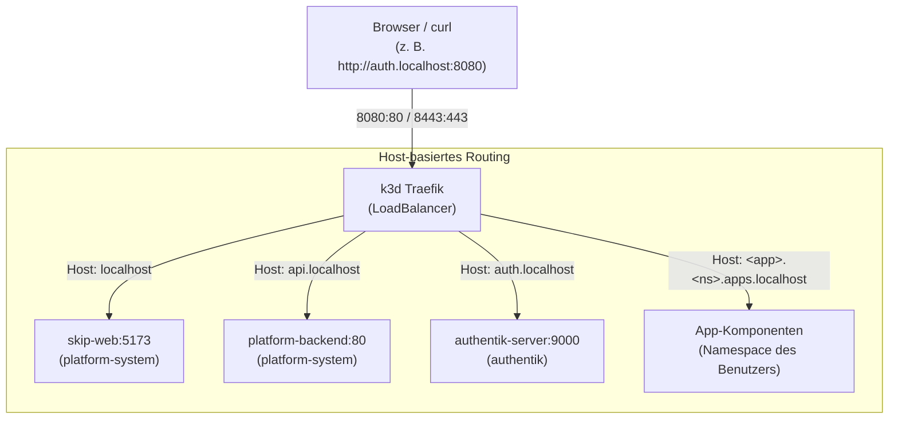

# Ingress & Netzwerk-Routing

Im lokalen k3d-Cluster laufen alle HTTP-Anfragen über den in k3d enthaltenen **Traefik**-Ingress-Controller. So sind Frontend, Backend und Authentik über einen Einstiegspunkt (`127.0.0.1:8080`) mit sprechenden `*.localhost`-Hosts erreichbar.

!!! info "Zuständigkeit"
    Der `localhost`-Ingress gehört zum lokalen Dev-Loop und bleibt in diesem Repository. Reale Domains, TLS, IngressClasses und External-DNS liegen im Infrastruktur-Repository (siehe [Repository-Grenze](../architecture/repository-boundary.md)).

---

## 🏗️ Funktionsweise

`deploy/local/k3d-cluster.yaml` bindet den k3d-Loadbalancer auf `127.0.0.1:8080` (HTTP) und `127.0.0.1:8443` (HTTPS). Traefik routet anhand des `Host`-Headers:



### `*.localhost`
Browser und moderne Resolver lösen gemäß RFC 6761 alle `*.localhost`-Namen auf `127.0.0.1` auf – ein Eintrag in `/etc/hosts` ist nicht nötig. Für `curl` kann der Host-Header gesetzt werden (siehe unten).

---

## 🗺️ Routen

| URL | Ziel-Service | Namespace | Definiert in |
| :--- | :--- | :--- | :--- |
| `http://localhost:8080` | `skip-web:http` (5173) | `platform-system` | `deploy/local/ingress.yaml` |
| `http://api.localhost:8080` | `platform-backend:http` (80) | `platform-system` | `deploy/local/ingress.yaml` |
| `http://auth.localhost:8080` | `authentik-server:http` (9000) | `authentik` | `deploy/local/dependencies/authentik/ingress.yaml` |
| `http://<app>.<namespace>.apps.localhost:8080` | Service der Komponente | Namespace des Benutzers | Application-RGD (`deploy/crds/application-rgd.yaml`), pro Komponente |

Ein Ingress muss im Namespace seines Ziel-Services liegen, deshalb bringt die Authentik-Dev-Fixture ihren eigenen Ingress mit.

## 🚀 URLs der deployten Apps

Jede App hat eine eindeutige Adresse. Für jede Komponente mit einem `expose` vom Typ `http` legt KRO aus der Application-RGD einen Ingress an; das Backend berechnet den Host und liefert die URL im API-Response (`url` der App und je Komponente) – die Deployments-Ansicht zeigt sie als **Öffnen**-Button.

| Komponente | Host |
| :--- | :--- |
| erste HTTP-Komponente des Templates | `<app>.<namespace>.<APPS_DOMAIN>` |
| weitere HTTP-Komponenten | `<app>-<komponente>.<namespace>.<APPS_DOMAIN>` |

Beispiel: das Notebook `my-notebook` im Namespace `user-max-mustermann` ist unter `http://my-notebook.user-max-mustermann.apps.localhost:8080` erreichbar. Konfiguration in `deploy/local/.env` (Secret `platform-env`, gelesen vom Backend):

| Variable | Lokal | Bedeutung |
| :--- | :--- | :--- |
| `APPS_DOMAIN` | `apps.localhost` | Domain-Suffix der App-Hosts; leer = keine Ingresses |
| `APPS_INGRESS_CLASS` | `traefik` | `ingressClassName` der erzeugten Ingresses |
| `APPS_SCHEME` / `APPS_PUBLIC_PORT` | `http` / `8080` | Nur für die angezeigte URL (Port leer = Standardport) |

In einer produktiven Umgebung setzt das Infrastruktur-Repository eine echte Wildcard-Domain (`*.apps.example.org`) samt TLS; der Mechanismus bleibt derselbe.

!!! warning "Apps sind nicht durch Authentik geschützt"
    Der Ingress leitet direkt an die Komponente weiter. Ob die App selbst eine Anmeldung verlangt, bestimmt das Template (Jupyter: Parameter `accessToken`, Open WebUI: `WEBUI_AUTH=false`). Ein Forward-Auth über Authentik am Ingress ist ein sinnvoller nächster Schritt.

---

## ➕ Neue Route hinzufügen

1. Der Service braucht einen benannten Port (z. B. `name: http`).
2. Ingress-Block in `deploy/local/ingress.yaml` (Plattform-Komponenten) bzw. in der jeweiligen Dev-Fixture unter `deploy/local/dependencies/<dienst>/` ergänzen:

    ```yaml
    ---
    apiVersion: networking.k8s.io/v1
    kind: Ingress
    metadata:
      name: mein-dienst
      labels:
        app.kubernetes.io/name: mein-dienst
        app.kubernetes.io/part-of: skip-platform
    spec:
      ingressClassName: traefik
      rules:
        - host: mein-dienst.localhost
          http:
            paths:
              - path: /
                pathType: Prefix
                backend:
                  service:
                    name: mein-dienst
                    port:
                      name: http
    ```

3. Anwenden: Plattform-Routen deployt `make dev` (Skaffold) automatisch; Fixture-Routen mit `kubectl apply -k deploy/local/dependencies/<dienst>` bzw. dem passenden `make install-*`-Target.

---

## 🧪 Diagnose

```bash
kubectl get ingress -A
# NAMESPACE         NAME                 CLASS     HOSTS                                 ...
# authentik         authentik            traefik   auth.localhost
# platform-system   platform-backend     traefik   api.localhost
# platform-system   skip-web             traefik   localhost
# team-data         my-notebook-jupyter  traefik   my-notebook.team-data.apps.localhost

curl -I -H "Host: auth.localhost" http://localhost:8080/          # Authentik
curl -H "Host: api.localhost" http://localhost:8080/healthz       # Backend
curl -I -H "Host: my-notebook.team-data.apps.localhost" http://localhost:8080/   # App
```

| Problem | Ursache | Lösung |
| :--- | :--- | :--- |
| `404 page not found` von Traefik | Host passt zu keiner Ingress-Regel | URL prüfen (`auth.localhost:8080`, nicht `localhost:8080`) |
| Verbindung abgelehnt | Port vergessen | k3d bindet Port 80 auf Host-Port `8080` – immer `:8080` anhängen |
| Subdomain wird nicht aufgelöst | Alter Browser oder restriktiver Resolver | `curl` mit `Host`-Header testen; Chrome/Firefox lösen `*.localhost` selbst auf |
