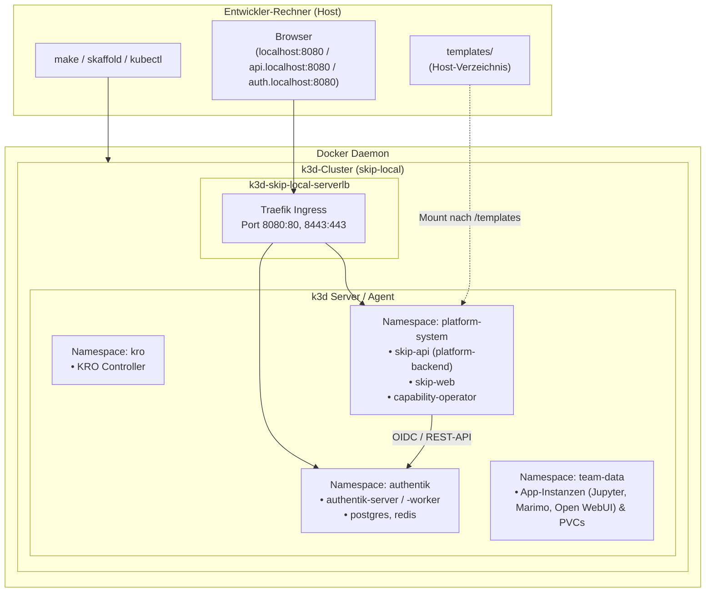

# Lokales Deployment & Test-Workflows

In diesem Leitfaden wird detailliert beschrieben, wie das lokale Deployment der SKIP-Plattform aufgebaut ist, wie es gestartet, überwacht und bereinigt wird.

---

## 🏗️ Architektur des lokalen Deployments

Das lokale Test-Setup besteht aus einem leichtgewichtigen **k3d-Cluster**, der auf dem lokalen Docker-Daemon läuft:



Produktive Shared Services (Authentik, MinIO, LiteLLM) betreibt das Infrastruktur-Repository. Lokal gibt es Authentik als Dev-Fixture im Namespace `authentik` (`make install-authentik`, siehe [Authentik](../components/authentik.md)) und LiteLLM im Namespace `litellm` (`make install-litellm`), MinIO nicht (siehe [Shared Services](../components/services.md)). Beide liegen in eigenen Namespaces, damit Ctrl-C in `skaffold dev` sie nicht mit `platform-system` löscht.

---

## 🚀 Schritt-für-Schritt Ablauf beim Starten

Wenn du `make init-local` ausführst, laufen im Hintergrund folgende Phasen ab:

### Phase 1: Cluster-Erstellung (`make create-cluster`)
- Liest `deploy/local/k3d-cluster.yaml`.
- Erstellt einen Cluster namens `skip-local` mit 1 Server und 1 Agent.
- Bindet Host-Ports an den Traefik LoadBalancer (`127.0.0.1:8080:80` und `127.0.0.1:8443:443`).
- Mountet `${PWD}/templates` als `/templates` in alle Nodes – deshalb muss das Kommando aus dem Repository-Root laufen.

### Phase 2: Umgebungsdatei (`make load-env`)
- Kopiert `deploy/local/.env.example` nach `deploy/local/.env`, falls die Datei noch nicht existiert (gitignored).
- Kustomize erzeugt daraus das Secret `platform-env` (`API_URL`, `ALLOWED_NAMESPACES`, `LITELLM_*`, `AUTHENTIK_*`, `OIDC_*`).

### Phase 3: Bootstrap (`make bootstrap`)
- Installiert KRO via Helm aus der offiziellen OCI-Registry (`oci://ghcr.io/kro-run/kro/kro`) in den Namespace `kro`.
- Wendet die CRDs/ResourceGraphDefinitionen aus `deploy/crds/` an: die generische `Application`-RGD (`application-rgd.yaml`) und die `CapabilityClaim`-CRD (`capabilityclaims-crd.yaml`).
- Wartet (`kubectl wait`), bis die CRD `capabilityclaims.platform.skip.io` etabliert ist.
- Legt den lokalen Beispiel-Tenant `team-data` samt ResourceQuota aus `deploy/local/bootstrap/tenant-team-data.yaml` an.

### Phase 4: Authentik-Fixture (`make install-authentik`)
- Legt Namespace `authentik` und das Secret `authentik-env` (`AUTHENTIK_SECRET_KEY`, `AUTHENTIK_POSTGRES_PASSWORD`, `AUTHENTIK_API_TOKEN`, `OIDC_CLIENT_ID`, `OIDC_CLIENT_SECRET`) aus `deploy/local/.env` an.
- Wendet `deploy/local/dependencies/authentik/` an (Postgres, Redis, Server, Worker, Ingress `auth.localhost`, Blueprint als ConfigMap) und wartet auf den Rollout des Servers.
- Der Blueprint legt beim ersten Start OIDC-Provider, Gruppen (`skip-admins`, `team-data`), Testbenutzer und den API-Token für `skip-api` an.

### Phase 5: LiteLLM-Fixture (`make install-litellm`)
- Legt Namespace `litellm` und das Secret `litellm-env` (`PROXY_MASTER_KEY` = `LITELLM_MASTER_KEY`, `MISTRAL_API_KEY`) aus `deploy/local/.env` an.
- Installiert das Helm-Chart `oci://ghcr.io/berriai/litellm-helm` mit `deploy/local/dependencies/litellm/values.yaml` (Modelle `mistral-small`, `mistral-large`, Standalone-Postgres) und wartet, bis es bereit ist.
- Wird übersprungen, wenn `MISTRAL_API_KEY` leer ist.

### Phase 6: Dev-Loop (`make dev`)
- Ruft `skaffold dev` auf:
  - Baut die Container-Images `skip-api`, `skip-web` und `capability-operator` lokal (kein Push, Tag `:dev`).
  - Wendet das Kustomize-Overlay `deploy/local` an: Namespace `platform-system`, die drei Deployments samt RBAC (`deploy/skip-api/rbac.yaml`, `deploy/capability-operator/rbac.yaml`), das Secret `platform-env` und die Ingress-Routen.
  - Bleibt im Vordergrund, streamt die Logs aller Pods und synchronisiert Codeänderungen (siehe unten).
- CRDs und RGDs aus `deploy/crds/` sind bewusst nicht Teil von Skaffold (Ctrl-C würde sie samt aller Instanzen löschen) – dafür `make bootstrap` erneut ausführen.

!!! note "Templates"
    Es gibt keine eigene Phase für Templates: Das Backend liest die `template.yaml`-Dateien direkt aus dem gemounteten Verzeichnis `/templates` und übersetzt sie beim Deploy in die generische `Application`-RGD aus `deploy/crds/`, siehe [Template-System](../app-templates/index.md).

---

## 🛠️ Arbeitsmodi im Alltag

### 1. Erststart oder kompletter Neuaufbau
```bash
make init-local      # erster Start
make reset-local     # Cluster löschen und komplett neu aufsetzen (= make nuke)
```

### 2. Wiedereinstieg mit Live-Entwicklung
Wenn der Cluster bereits existiert und du am Code arbeitest:
```bash
make dev
```
Skaffold synchronisiert Änderungen und baut Images bei Bedarf inkrementell neu:
- **Python** (`apps/skip-api/**/*.py`): File-Sync, uvicorn lädt per `--reload` neu.
- **Frontend** (`apps/skip-web/src/**`, `static/**`): File-Sync, Vite Hot Module Replacement.
- **Templates** (`templates/`): Host-Mount, Änderungen sind sofort sichtbar.
- **Operator** (`apps/capability-operator/**`): Image-Rebuild und Redeploy.
- `Dockerfile`, `pyproject.toml`/`uv.lock`, `package.json`: Image-Rebuild und Redeploy.
- Manifeste unter `deploy/`: werden neu applied.

**Ctrl-C** beendet Skaffold und räumt die Deployments aus dem Cluster; der Cluster selbst bleibt bestehen.

### Zugriff
Es gibt keine Port-Forwards; alles läuft über den Traefik-Ingress (`deploy/local/ingress.yaml`):
- Web: `http://localhost:8080` (Login mit `akadmin`/`AdminPw` oder `max.mustermann`/`Start123!`)
- API: `http://api.localhost:8080` (Swagger UI: `http://api.localhost:8080/docs`)
- Authentik: `http://auth.localhost:8080` (Ingress der Dev-Fixture, siehe [Ingress & Routing](ingress.md))
- Deployte Apps: `http://<app>.<namespace>.apps.localhost:8080` (Button **Öffnen** in der Deployments-Ansicht)

Für CLI-Tools, die `*.localhost` nicht auflösen: `127.0.0.1 api.localhost` in `/etc/hosts` eintragen oder `curl -H 'Host: api.localhost' http://localhost:8080/healthz`.

---

## 🩺 Diagnose & Troubleshooting

### Cluster-Status überprüfen
```bash
make status                        # KRO-Pods, RGDs, Authentik/LiteLLM-Pods, CapabilityClaims
kubectl get pods -n platform-system
kubectl get pods -n authentik
curl http://api.localhost:8080/healthz
```

### Logs der Plattform-Komponenten anzeigen
```bash
# Logs des Backends
kubectl logs -n platform-system deploy/platform-backend -f

# Logs des Frontends
kubectl logs -n platform-system deploy/skip-web -f

# Logs des Capability-Operators
kubectl logs -n platform-system deploy/capability-operator -f

# Logs des KRO Controllers
kubectl logs -n kro deploy/kro -f

# Logs von Authentik (Blueprint-Import, Login-Fehler)
kubectl logs -n authentik deploy/authentik-server -f
kubectl logs -n authentik deploy/authentik-worker -f
```

### Kustomize-Overlay rendern
```bash
make render    # = kubectl kustomize deploy/local, zeigt die genaue Ursache bei Skaffold-Fehlern
```

### Häufige Probleme und Lösungen

| Problem | Ursache | Lösung |
| :--- | :--- | :--- |
| `Port 8080 already in use` | Ein anderer lokaler Dienst belegt Port 8080 (oder 8443) | Prüfe mit `lsof -i :8080` oder passe die Ports in `deploy/local/k3d-cluster.yaml` an (dann auch `API_URL` in `apps/skip-web/.env`) |
| Template wird nicht angezeigt | `template.yaml` fehlt oder ungültig | Katalog neu einlesen: `curl -X POST -H 'X-User: dev@skip.de' http://api.localhost:8080/api/templates/reload`; Parsing prüfen mit `make test` |
| Backend findet keine Templates | Cluster wurde nicht aus dem Repository-Root erstellt, der Mount zeigt ins Leere | `make reset-local` aus dem Repository-Root |
| Skaffold bricht mit Kustomize-Fehler ab | `deploy/local/.env` fehlt oder ein referenziertes Verzeichnis ist leer | `make load-env`, Ursache mit `make render` anzeigen |
| Login schlägt fehl (`Token exchange failed`) oder Web-UI zeigt nur die Login-Seite | Authentik nicht installiert / noch nicht bereit, oder `OIDC_*` in `.env` passen nicht zum Blueprint | `kubectl get pods -n authentik`, ggf. `make install-authentik`; Details in [Authentik](../components/authentik.md) |
| API antwortet `401` | Kein Bearer-Token bzw. `X-User`-Header, oder Token abgelaufen | Neu anmelden; für `curl` lokal `-H 'X-User: dev@skip.de'` verwenden |
| Backend-Pod `CrashLoopBackOff` | Bootstrap nicht ausgeführt (CRDs fehlen) | `kubectl logs -n platform-system deploy/platform-backend`, dann `make bootstrap` |
| CapabilityClaim bleibt `CapabilityUnavailable` oder `ProvisioningFailed` | LiteLLM nicht installiert (`MISTRAL_API_KEY` leer) oder noch nicht bereit | `kubectl get pods -n litellm`, ggf. `make install-litellm`; Ursache in `kubectl logs -n platform-system deploy/capability-operator`; `forbidden` deutet auf fehlende RBAC in `deploy/capability-operator/rbac.yaml` |
| `Phase: Failed` beim Starten einer App | KRO konnte Ressourcen nicht erzeugen oder Image nicht ziehen | Prüfe `kubectl describe applications.kro.run <name> -n team-data` und `kubectl get pods -n team-data` |
| Images werden nicht aktualisiert | Skaffold-Cache | `make dev` neu starten oder `skaffold build --cache-artifacts=false` |
| Vollständig blockierter Zustand | Inkonsistenter lokaler Zustand | Führe `make reset-local` (oder `make nuke`) aus |
