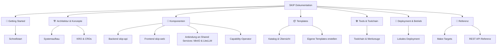

# SKIP Plattform Dokumentation

Willkommen zur offiziellen Dokumentation der **SKIP Plattform** der FH Südwestfalen.

SKIP ist eine moderne, cloud-native Plattform zur deklarativen Bereitstellung, Verwaltung und Nutzung von Anwendungs-Templates (wie Jupyter Notebooks, Marimo Notebooks, APIs und Datenanalyse-Workspaces) auf Kubernetes.

---

## 🎯 Was ist die SKIP Plattform?

Die Bereitstellung von Entwicklungs- und Data-Science-Umgebungen auf Kubernetes ist oft mit komplexen YAML-Manifesten, RBAC-Konfigurationen, Ingress-Routen und Secret-Management verbunden. 

**SKIP vereinfacht diesen Prozess radikal:**

- **Deklarative Templates**: Anwendungen werden über **KRO (Kube Resource Orchestrator)** als composable Kubernetes-Ressourcen definiert.
- **Benutzerfreundliches Web-Frontend**: Entwickler und Data Scientists können über eine moderne SvelteKit-Oberfläche per Klick vorkonfigurierte Tools starten.
- **Dynamische Formulargenerierung**: Eingabefelder im Frontend werden vollautomatisch aus den OpenAPI-Schemas der Kubernetes-CRDs abgeleitet.
- **Automatisiertes Provisioning**: Authentifizierungs-Token, Storage-Volumes und Secrets werden transparent vom Backend generiert und verwaltet.
- **Anbindung an Shared Services**: Anbindung an Shared Services (MinIO, LiteLLM) des Infrastruktur-Repositorys – die Plattform betreibt sie nicht selbst, sondern konsumiert sie (siehe [Repository-Grenze](architecture/repository-boundary.md)).
- **Capability-Operator**: Templates fordern Plattform-Capabilities (z. B. LLM-Zugang) deklarativ an; ein Kopf-Operator provisioniert die daraus entstehenden `CapabilityClaim`s, aktuell LiteLLM-Keys.
- **Entwicklerfreundliche Toolchain**: Ein einziges `make init-local` genügt, um einen vollständigen lokalen k3d-Cluster mit allen Komponenten und Templates hochzufahren.

---

## 🚀 Schnellstart

Möchtest du die Plattform direkt lokal ausprobieren?

```bash
# 1. Lokalen k3d-Cluster erstellen, KRO booten, Images bauen und den Dev-Loop
#    mit Live-Reload starten (= create-cluster + load-env + bootstrap + dev)
make init-local

# 2. Später wieder einsteigen, wenn der Cluster bereits existiert
make dev
```

Die Dienste sind anschließend über den k3d-Ingress (Traefik, Port 8080) erreichbar:

- 🌐 **Web-Interface**: [http://localhost:8080](http://localhost:8080)
- ⚙️ **Platform API**: [http://api.localhost:8080](http://api.localhost:8080) (oder [http://api.localhost:8080/docs](http://api.localhost:8080/docs) für Swagger UI)

👉 Ausführliche Schritt-für-Schritt-Anleitung: [Schnellstart-Guide](getting-started/quickstart.md)

---

## 🧭 Dokumentationsstruktur

Die Dokumentation gliedert sich in folgende Hauptbereiche:



### 📚 Themen im Überblick

- **[Schnellstart](getting-started/quickstart.md)**: Voraussetzungen, Installation und Start der Plattform in wenigen Minuten.
- **[Systemarchitektur](architecture/index.md)**: Schichtenmodell, Datenfluss und Zusammenspiel aller Komponenten.
- **[KRO & CRD Modell](architecture/kro-and-crds.md)**: Wie der Kube Resource Orchestrator und `AppTemplate`-Ressourcen funktionieren.
- **[Backend (`skip-api`)](components/backend.md)**: FastAPI-Backend, Kubernetes Client-Integration und Secret-Provisioning.
- **[Frontend (`skip-web`)](components/frontend.md)**: SvelteKit Web-App, dynamische Formulargenerierung und Dashboard.
- **[Identity & SSO (Authentik)](components/authentik.md)**: OIDC-Login, JWT-Validierung, persönliche Namespaces und App-Sharing über Authentik-Gruppen.
- **[Capability-Operator](components/capability-operator.md)**: Capability-Operator: provisioniert CapabilityClaims, z. B. LiteLLM-Keys.
- **[Shared Services](components/services.md)**: Anbindung an Shared Services (MinIO, LiteLLM) des Infrastruktur-Repositorys.
- **[Templates](app-templates/index.md)**: Vorhandene Templates (Jupyter, Marimo, Open WebUI) und [Anleitung zur Template-Erstellung](app-templates/authoring.md).
- **[Tools & Befehle](tools/index.md)**: Übersicht aller genutzten Werkzeuge sowie ein **[Befehls-Cheatsheet für kubectl, uv, make & kro](tools/commands-guide.md)**.
- **[Lokales Deployment](deployment/local.md)**: Detaillierter Leitfaden für lokale Cluster und Test-Deployments.
- **[Referenz](reference/make.md)**: Befehlsreferenz für die Make-Targets des `Makefile` und die [REST API](reference/api.md).