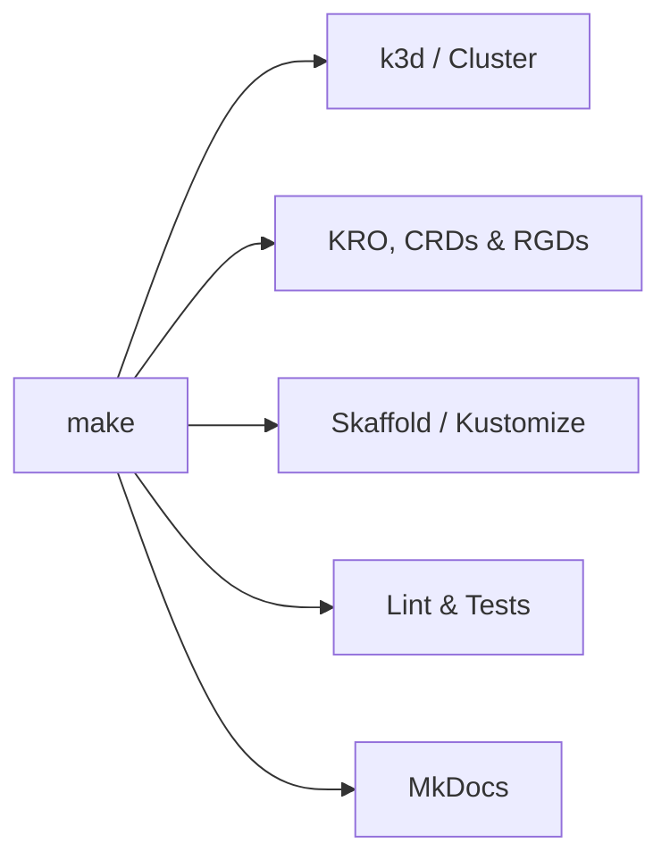
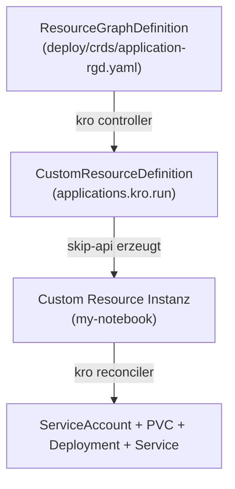

# Entwickler-Befehle & Cheatsheet

Diese Seite bietet eine praxisorientierte Anleitung und Befehlsreferenz für die wichtigsten Entwickler-Tools im Projekt: **`make`**, **`kubectl`**, **`uv`** und **`kro`** (sowie ergänzend **`k3d`** und **`skaffold`**).

---

## 1. ⚡ `make` – Der zentrale Task-Runner

GNU `make` ist der Standard-Einstiegspunkt für alle Automatisierungs- und Entwicklungs-Tasks im Repository. Das `Makefile` liegt im Repository-Root; alle Targets von dort ausführen, da der k3d-Cluster `${PWD}/templates` mountet.



### 📋 Wichtigste Befehle

| Befehl | Zweck | Wann nutzen? |
| :--- | :--- | :--- |
| `make help` *(oder `make`)* | Zeigt alle im `Makefile` definierten Targets an | Zur schnellen Orientierung |
| `make init-local` | Erstellt den k3d-Cluster, legt `.env` an, installiert KRO/CRDs/Tenant und startet den Dev-Loop (= `create-cluster` + `load-env` + `bootstrap` + `dev`) | Einmalig beim Start oder nach dem Löschen |
| `make dev` | Startet `skaffold dev`: baut die Images, deployt `deploy/local` und synct Codeänderungen live | Wiedereinstieg, wenn der Cluster schon existiert |
| `make create-cluster` | Erstellt nur den k3d-Cluster laut `deploy/local/k3d-cluster.yaml` | Teilschritt von `init-local` |
| `make load-env` | Legt `deploy/local/.env` aus `.env.example` an, falls nicht vorhanden | Teilschritt von `init-local` |
| `make bootstrap` | Installiert KRO per Helm, wendet `deploy/crds/` (Application-RGD, CapabilityClaim-CRD) und `deploy/local/bootstrap/` (Tenant `team-data`) an | Teilschritt von `init-local`; erneut nach Änderungen an CRDs/RGDs |
| `make status` | Zeigt KRO-Pods, RGDs und CapabilityClaims auf einen Blick | Zur schnellen Funktionsprüfung |
| `make render` | Rendert das lokale Kustomize-Overlay (`kubectl kustomize deploy/local`) | Fehlersuche bei Skaffold-/Kustomize-Fehlern |
| `make lint` | `ruff check apps` | Vor dem Commit |
| `make test` | `pytest` über Apps, `packages/skip-capability-sdk` und `plugins/capabilities` (lädt die echten Templates) | Vor dem Commit, nach Template-Änderungen |
| `make check` | `lint` + `test` (entspricht der Python-CI) | Vor dem Push |
| `make stop-local` | Pausiert den k3d-Cluster (spart Akku & RAM) | Am Feierabend |
| `make start-local` | Setzt den pausierten k3d-Cluster fort (danach `make dev`) | Am nächsten Tag |
| `make restart-local` | Startet den k3d-Cluster neu | Bei hängendem Cluster |
| `make delete-local` | Löscht den k3d-Cluster | Zum Aufräumen |
| `make reset-local` *(oder `make nuke`)* | Löscht den Cluster restlos und setzt ihn von Grund auf neu auf (= `delete-local` + `init-local`) | Bei inkonsistentem/kaputtem Clusterzustand |
| `make docs-start` | Startet den MkDocs-Server unter `http://127.0.0.1:8001` | Zur Vorschau der Dokumentation |
| `make docs-stop` | Beendet den MkDocs-Server | Nach der Doku-Arbeit |
| `make docs-clean` | Beendet MkDocs und löscht `site/` | Zum Aufräumen |

---

## 2. ☸️ `kubectl` – Kubernetes Cluster-Management

[`kubectl`](https://kubernetes.io/docs/reference/kubectl/) steuert und inspiziert die Ressourcen auf dem Kubernetes-Cluster.

### 🔍 Cluster- und Pod-Status untersuchen

```bash
# Alle Pods in allen relevanten Namespaces anzeigen
kubectl get pods -A

# Pods im Plattform-System anzeigen (platform-backend, skip-web, capability-operator)
kubectl get pods -n platform-system

# Pods im KRO-Controller Namespace anzeigen
kubectl get pods -n kro

# User-Pods im Tenant-Namespace anzeigen (z.B. laufende Jupyter/Marimo Instanzen)
kubectl get pods -n team-data

# CapabilityClaims (z.B. LLM-Zugang) und ihren Ready-Status anzeigen
kubectl get claims -A
```

### 🪵 Logs und Debugging

```bash
# Live-Logs des FastAPI-Backends verfolgen
kubectl logs -n platform-system deploy/platform-backend -f

# Live-Logs des Frontends verfolgen
kubectl logs -n platform-system deploy/skip-web -f

# Live-Logs des Capability-Operators verfolgen
kubectl logs -n platform-system deploy/capability-operator -f

# Live-Logs des KRO Controllers verfolgen
kubectl logs -n kro deploy/kro -f

# Detaillierte Fehlerbeschreibung eines Pods / Events auslesen
kubectl describe pod <pod-name> -n <namespace>

# Interaktive Shell in einem laufenden Container öffnen
kubectl exec -it <pod-name> -n <namespace> -- /bin/sh
```

### 🔌 API-Zugriff von der Kommandozeile

Skaffold richtet keine Port-Forwards ein; Frontend und API sind über den Traefik-Ingress des k3d-Clusters erreichbar (`http://localhost:8080` bzw. `http://api.localhost:8080`). Browser lösen `*.localhost` automatisch auf, viele CLI-Tools nicht:

```bash
# Variante 1: Host-Header setzen
curl -H 'Host: api.localhost' http://localhost:8080/healthz

# Variante 2: Eintrag in /etc/hosts anlegen (127.0.0.1 api.localhost), danach:
curl http://api.localhost:8080/healthz
```

---

## 3. 🐍 `uv` – Python Paket- & Workspace-Manager

[`uv`](https://github.com/astral-sh/uv) ist ein extrem schneller Python-Paketmanager. Er verwaltet den Workspace im Repository-Root mit den Members `apps/skip-api`, `apps/capability-operator`, `packages/skip-capability-sdk` und `plugins/capabilities/*` sowie die Dependency-Gruppen `dev` (pytest, ruff, httpx) und `docs` (mkdocs).

### 📦 Workspace- & Abhängigkeitsverwaltung

```bash
# Alle Abhängigkeiten des Workspace inklusive dev- und docs-Gruppe installieren / synchronisieren
uv sync --all-groups

# Nur Abhängigkeiten inklusive Dokumentations-Tools (mkdocs-material etc.) synchronisieren
uv sync --group docs

# Nur Abhängigkeiten für skip-api synchronisieren
uv sync --package skip-api

# Neues Paket zu skip-api hinzufügen
uv add fastapi --package skip-api

# Lockfile aktualisieren
uv lock
```

### 🚀 Ausführen von Skripten und Tools

Mit `uv run` führst du Befehle in der isolierten virtuellen Umgebung aus, ohne das `venv` manuell mit `source .venv/bin/activate` aktivieren zu müssen:

```bash
# Lint und Tests (entspricht make lint / make test)
uv run --group dev ruff check apps
uv run --group dev pytest apps/skip-api apps/capability-operator packages/skip-capability-sdk plugins/capabilities

# Code formatieren
uv run --group dev ruff format apps

# Backend lokal außerhalb des Clusters starten (Templates vom Host, Kubeconfig gegen den k3d-Cluster)
TEMPLATES_DIR=templates uv run --package skip-api uvicorn main:app --app-dir apps/skip-api --reload

# Dokumentation manuell bauen
uv run --group docs mkdocs build

# Dokumentationsserver lokal starten (auf Port 8001)
uv run --group docs mkdocs serve -a 127.0.0.1:8001
```

---

## 4. 🧮 `kro` – Kube Resource Orchestrator

[KRO](https://kro.run/) orchestriert Multi-Ressourcen-Graphen. In SKIP werden damit Templates wie Jupyter Notebooks in echte Kubernetes-Ressourcen übersetzt. Die generische `Application`-RGD liegt in `deploy/crds/application-rgd.yaml` (installiert per `make bootstrap`); das Backend übersetzt jedes AppTemplate in eine Instanz davon.



### 📋 KRO-Ressourcen inspizieren

```bash
# Alle registrierten ResourceGraphDefinitions anzeigen
kubectl get resourcegraphdefinitions
# Kurzform:
kubectl get rgd

# Details einer RGD inspizieren (Schema, Resources, Status)
kubectl describe rgd application
```

### 🧪 KRO-Instanzen (Deployments) prüfen

Wenn ein Benutzer ein Notebook (z.B. `my-notebook`) über die Web-UI gestartet hat:

```bash
# Alle Instanzen des KRO-Kinds 'Application' im Namespace anzeigen (eine je Komponente)
kubectl get applications.kro.run -n team-data

# Detaillierten KRO-Zustand und Statusbedingungen abfragen
kubectl describe applications.kro.run my-notebook-jupyter -n team-data

# Alle Ressourcen einer App (alle Komponenten) ansehen
kubectl get all,pvc -n team-data -l app.kubernetes.io/part-of=my-notebook
```

### 🛠️ Katalog neu laden & Capabilities prüfen

Der Katalog wird aus den `template.yaml`-Dateien im gemounteten `templates/`-Verzeichnis gelesen; nach Änderungen an der Application-RGD genügt `make bootstrap`:

```bash
# CapabilityClaims der Apps und ihren Status anzeigen
kubectl get claims -A

# Application-RGD nach Aenderungen neu anwenden
kubectl apply -f deploy/crds/application-rgd.yaml

# 3. Katalog des Backends neu einlesen und anzeigen
curl -X POST -H 'X-User: dev@skip.de' http://api.localhost:8080/api/templates/reload
curl -H 'X-User: dev@skip.de' http://api.localhost:8080/api/templates
```

---

## 5. 🚢 `k3d` & `skaffold` Cheatsheet

### `k3d` (Cluster-Ebene)
```bash
# Cluster-Liste anzeigen
k3d cluster list

# Container-Images manuell in den k3d-Cluster laden (ohne Registry-Push)
k3d image import <image-name>:latest -c skip-local

# Kubeconfig des k3d Clusters neu in die lokale ~/.kube/config einbinden
k3d kubeconfig merge skip-local --set-current
```

### `skaffold` (Dev & Pipeline)
```bash
# Plattform einmalig bauen und deployen
skaffold run

# Plattform mit Live-Reload und automatischer Log-Ausgabe starten (= make dev)
skaffold dev

# Images ohne Cache neu bauen, falls Änderungen nicht ankommen
skaffold build --cache-artifacts=false

# Alle von Skaffold deployten Plattform-Ressourcen löschen
skaffold delete
```

---

## 💡 Typischer Entwickler-Workflow im Alltag

```bash
# 1. Lokale Arbeitsumgebung starten (Cluster existiert bereits)
make dev

# 2. In einem zweiten Terminal: Status oder Logs prüfen
make status
kubectl get pods -n platform-system

# 3. Neues Template hinzugefügt? Katalog neu einlesen
curl -X POST -H 'X-User: dev@skip.de' http://api.localhost:8080/api/templates/reload

# 4. Vor dem Commit: Lint + Tests
make check

# 5. Feierabend
STRG+C (beendet make dev und räumt die Deployments weg)
make stop-local
```
