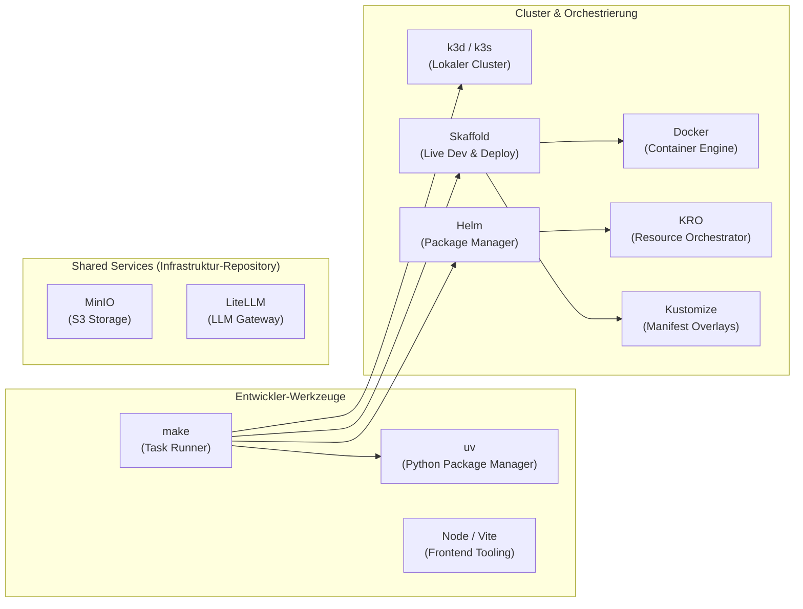

# Tools & Toolchain

Die SKIP-Plattform setzt auf eine moderne, standardisierte und erprobte Toolchain für Entwicklung, Containerisierung, Orchestrierung und Dokumentation.

---

## 🛠️ Tool-Übersicht

---

## 🔍 Die Tools im Detail

### 1. [GNU `make`](https://www.gnu.org/software/make/) – Task Runner
- **Zweck**: Zentraler Einstiegspunkt für alle Entwicklungs-, Test- und Deployment-Workflows. Das `Makefile` liegt im Repository-Root; `make help` (oder einfach `make`) listet alle Targets mit Beschreibung.
- **Hinweis**: Alle Targets aus dem Repository-Root ausführen – der k3d-Cluster mountet `${PWD}/templates`.
- **Wichtigste Targets**: `make init-local`, `make dev`, `make status`, `make check`, `make reset-local`.

### 2. [`k3d`](https://k3d.io/) & [`k3s`](https://k3s.io/) – Lokaler Kubernetes-Cluster
- **Zweck**: Startet vollständige Kubernetes-Cluster (K3s) innerhalb von Docker-Containern.
- **Konfiguration**: `deploy/local/k3d-cluster.yaml`.
- **Vorteile**:
  - Extrem ressourcensparend und schnell startend (< 15 Sekunden).
  - Integrierter Traefik Ingress Controller – darüber sind Frontend (`http://localhost:8080`) und API (`http://api.localhost:8080`) erreichbar.
  - Vorkonfigurierte Port-Weiterleitungen für HTTP (`8080:80`) und HTTPS (`8443:443`).
  - Mountet `templates/` als `/templates` in alle Nodes, sodass das Backend den Katalog direkt vom Host liest.

### 3. [`kro`](https://kro.run/) – Kube Resource Orchestrator
- **Zweck**: Deklarative Engine zur Definition von Multi-Ressourcen-Graphen.
- **Funktionsweise**: Wandelt `ResourceGraphDefinition` (RGD) YAML-Dateien in echte Kubernetes Custom Resource Definitions (CRDs) um und verwaltet deren Lebenszyklus und Statusaggregation.

### 4. [`skaffold`](https://skaffold.dev/) – Continuous Development & Deployment
- **Zweck**: Automatisiert den Build-, Push- und Deployment-Zyklus für Kubernetes-Apps.
- **Konfiguration**: `skaffold.yaml` im Repository-Root.
- **Features in SKIP** (`make dev` = `skaffold dev`):
  - Baut drei Images: `skip-api` und `capability-operator` (Kontext: Repo-Root) sowie `skip-web` (Kontext: `apps/skip-web`) – lokal ohne Push (`push: false`), Tag `:dev`, direkt in die k3d-Nodes.
  - Deployt das Kustomize-Overlay `deploy/local` und wendet Manifest-Änderungen unter `deploy/` automatisch neu an.
  - File-Sync für `skip-api` (`apps/skip-api/**/*.py`, uvicorn lädt per `--reload`) und `skip-web` (`src/**`, `static/**`, Vite HMR) – ohne Image-Rebuild.
  - Für den `capability-operator` gibt es keinen Sync (Kopf lädt Code nicht neu); Skaffold baut das Image bei Änderungen neu und deployt es.
  - Kein Port-Forwarding: Der Zugriff läuft über den Traefik-Ingress des k3d-Clusters (Port 8080).

### 5. [`kustomize`](https://kustomize.io/) & [`helm`](https://helm.sh/)
- **Kustomize**: Umgebungsneutrale Manifeste je Komponente unter `deploy/<name>/` (`skip-api`, `skip-web`, `capability-operator`, jeweils inkl. RBAC) werden vom lokalen Overlay `deploy/local` komponiert (Namespace `platform-system`, Ingress, `.env` → Secret `platform-env`). Produktive Overlays liegen im Infrastruktur-Repository.
- **Helm**: Wird in `make bootstrap` verwendet, um KRO direkt aus der OCI-Registry (`oci://ghcr.io/kro-run/kro/kro`) zu installieren.

### 6. [`uv`](https://github.com/astral-sh/uv) – Python Paket- und Workspace-Manager
- **Zweck**: Extrem schneller Python-Paketmanager (in Rust geschrieben).
- **Einsatz**: Verwaltet den Workspace im Repository-Root (Members: `apps/skip-api`, `apps/capability-operator`, `packages/skip-capability-sdk`, `plugins/capabilities/*`), die `dev`-Gruppe (pytest, ruff, httpx) und die `docs`-Gruppe (mkdocs). Einrichtung mit `uv sync --all-groups`.

### 7. SvelteKit & Tailwind CSS – Frontend-Tooling
- **SvelteKit 2 / Svelte 5**: Modernes, reaktives Web-Framework mit nativer TypeScript-Unterstützung.
- **Tailwind CSS v4**: Utility-First CSS-Framework für modernes, ansprechendes UI-Design.
- **Bits UI & shadcn-svelte**: Zugängliche, ungestylte bzw. vorformatierte UI-Primitives.

### 8. Shared Services (Infrastruktur-Repository)
- **MinIO**: S3-kompatibler Objektspeicher.
- **LiteLLM**: OpenAI-kompatibles LLM-Gateway; der `capability-operator` legt darüber mit dem Plugin `plugins/capabilities/litellm` virtuelle Keys für `CapabilityClaim`s an.
- **Zuständigkeit**: Beide Dienste werden nicht von diesem Repository deployt, sondern vom Infrastruktur-Repository betrieben (siehe [Repository-Grenze](../architecture/repository-boundary.md)). Wie die Plattform sie anbindet, beschreibt [Shared Services](../components/services.md).

### 9. Material for MkDocs – Dokumentation
- **Zweck**: Generierung dieser statischen Dokumentationsseite mit Suchfunktion, Dark-Mode und Mermaid-Diagrammen.
- **Befehl**: `make docs-start` (läuft auf `http://127.0.0.1:8001`), `make docs-stop`, `make docs-clean`.

---

👉 **Weiterführend**: Ein kompaktes Cheatsheet mit den wichtigsten Befehlen für den Entwicklungsalltag findest du im **[Entwickler-Befehle Guide](commands-guide.md)**.
